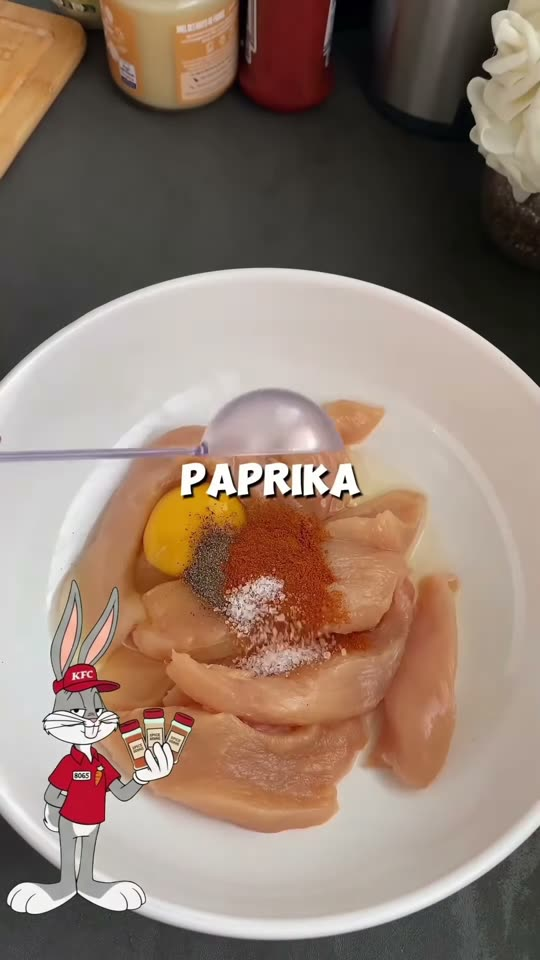
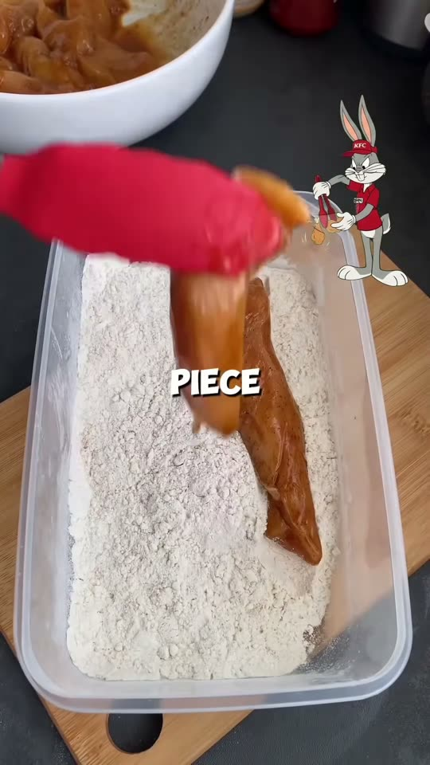
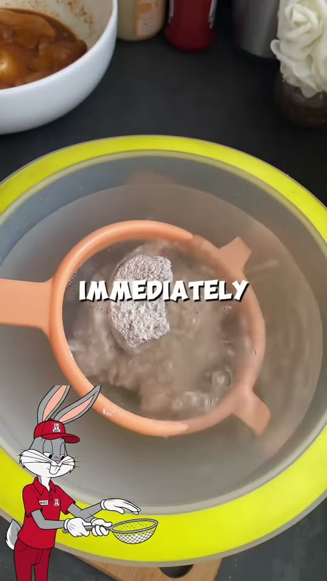
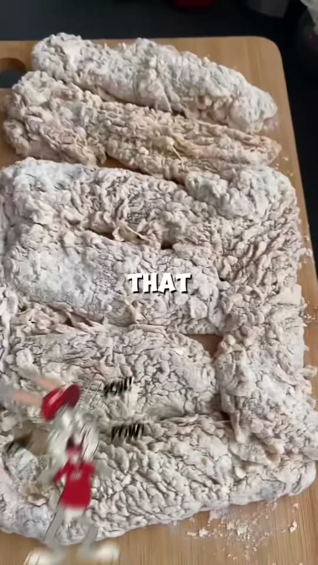

# Crispy chicken strips — *chicken tenders* 🇺🇸
**Serves 4 · Prep 20 min · Cook 25 min · Total about 45 min · Easy**

> **Before you start:** set out a thermometer, a deep pan, a lidded food box, a sieve and a draining rack.
> **Source:** user-supplied local video, “Video by bugs.bunny.cooks.mp4”, credited to **bugs.bunny.cooks** from its filename. Read from speech and frames; original post URL and platform unavailable. The video specifies **1 egg** and a **1-second cold-water dip**. All other amounts, serving size, temperatures and cooking times below are **typical working estimates**, not the creator's measurements. The “KFC secret recipe” and employment claims are unverified. Sauce ingredients are not given.

*Photo and all step frames: bugs.bunny.cooks, supplied local video; no original post link provided.*

## The story
- **Origins:** This is an American-style fried-chicken adaptation. KFC's own history places Sanders' roadside chicken business in Kentucky ([KFC](https://global.kfc.com/our-history)).
- **How it evolved:** This video uses boneless strips and an egg coating, unlike the brand's historical pressure-cooking method.
- **Fun fact:** KFC describes an eleven-spice blend; this clip names only salt, pepper and paprika. Treat it as a home interpretation.

## Grandma's tips 👵
No named grandmother's advice was found; these are credited practical tips.
- **[confirmed by several sources]** Leave room between pieces so the oil stays hot (Chef Dennis; The Seasoned Mom).
- **[confirmed by several sources]** Drain on a rack for a crisp underside (Chef Dennis; The Cozy Cook).
- **[confirmed by several sources]** Coat all sides thoroughly (all three comparison recipes).
- **Creator's technique:** shake in flour, dip for one second, then shake in flour again (video, 14–29 s); this precise water dip is not independently confirmed by the comparison recipes.

## Ingredients (4 servings)
### Chicken and egg coating
- [ ] **600 g chicken breast**, cut into roughly 2 cm thick strips *(typical)*
- [ ] **1 egg** *(video)*
- [ ] **4 g fine salt** *(typical)*
- [ ] **2 g sweet paprika** *(typical)*
- [ ] **1 g ground black pepper** *(typical)*
### Flour coating and frying
- [ ] **300 g plain flour** *(typical; coating supply, not all eaten)*
- [ ] **2 g sweet paprika** *(typical)*
- [ ] **3 g fine salt** *(typical)*
- [ ] **1 litre cold drinking water**, in a separate dipping bowl *(typical; discard afterward)*
- [ ] **1 litre neutral frying oil** *(typical purchase allowance; use enough for 3–4 cm depth in a suitably narrow deep pan, never more than half full)*

**Allergens:** egg and wheat/gluten. No sauce is included in these quantities.

## Equipment
Deep heavy pan, oil and meat thermometers, tongs, leakproof food box with spare headroom, sieve fitting the water bowl, rack over a tray. Do not pressure-fry at home.

## Plan / mise en place
- Cut and measure everything first. Keep raw chicken chilled until needed; do not rinse it.
- Combine the coating ingredients before handling raw chicken. Put the water bowl away from the stove.
- Allow about 20 minutes to prepare and coat, then 3 batches of approximately 6–8 minutes. No long marinade is specified in the video.

## Steps
1. [ ] Coat **600 g chicken strips** with **1 egg**, **4 g salt**, **2 g paprika** and **1 g black pepper**. *Every piece should be glossy and evenly seasoned.*

2. [ ] Mix **300 g flour**, **2 g paprika** and **3 g salt** in the lidded food box.
3. [ ] Add the coated strips in batches, close securely and shake until *no bare patches remain*. Lift into the sieve and shake off loose flour.

4. [ ] Lower the sieve into the bowl of **1 litre cold water** for **1 second**, then lift immediately and let drips stop. *This moistens the first coating; do not soak.* Keep this water away from hot oil.

⏱ **Timer: 1 second** — dip and lift immediately (video).

5. [ ] Return strips to the **same seasoned flour from step 2** and shake again. *The outside should look craggy and fully floured.* If working in batches, keep waiting raw strips refrigerated. Discard contaminated flour and water after coating.

6. [ ] Heat the **frying oil from the 1-litre allowance**, at **3–4 cm depth**, to **175°C** *(typical; Chef Dennis uses about 175°C)*. Leave plenty of headroom; never test oil with water. Let excess water drain before frying.
7. [ ] Lower a few coated strips into the oil with tongs. Fry the first side for **3–4 minutes** *(typical)*, adjusting heat to keep the oil near **175°C**. *The crust should set and turn golden; avoid crowding.*

⏱ **Timer: 3–4 min** — first side golden.

8. [ ] Turn and fry for another **3–4 minutes** *(typical)*. Check the thickest strip reaches **74°C internally**; extend cooking if needed. *Golden color alone cannot establish safety.* While frying, prepare a clean serving plate.

⏱ **Timer: 3–4 min** — second side golden and center at 74°C.

9. [ ] Drain on the rack. Return oil to **175°C** before the next batch; repeat steps 7–8. Serve promptly.

*All images above: frames from the supplied bugs.bunny.cooks video.*

## Timer cheat-sheet
| Step | Duration | Cue |
|---|---|---|
| 4 | 1 second | Lift out of water immediately |
| 7 | 3–4 min per batch | First side golden |
| 8 | 3–4 min per batch | Golden crust; 74°C inside |

## If it goes wrong
- Pale and greasy: let oil return to 175°C and reduce batch size.
- Brown outside, undercooked center: lower the heat slightly and continue to 74°C; cut thinner next time.
- Coating slides off: drain the water better and avoid turning before the crust sets.
- Flour stays powdery: check the brief dip wets the first coating and cover all sides on the second pass.

## Grocery list
- [ ] **Meat:** 600 g chicken breast *(typical)*
- [ ] **Dairy / Eggs:** 1 egg
- [ ] **Pantry / Spices:** 300 g plain flour; 4 g paprika; 7 g fine salt; 1 g black pepper; 1 litre frying oil *(all typical)*
- **Check you have:** 1 litre cold drinking water *(typical)*. Oil is a frying allowance, not an absorbed amount.

## Sources compared
The local video is the base; these English-language American recipes provide technique checks, not a replacement marinade.

| Source | Author | Why it counted | Notable detail |
|---|---|---|---|
| [The Cozy Cook](https://thecozycook.com/fried-chicken-tenders/) | Stephanie | Detailed frying guidance | 175–190°C; egg whites and breadcrumb/flour coating differ |
| [The Seasoned Mom](https://www.theseasonedmom.com/fried-chicken-tenders/) | Blair Lonergan | Explicit timing and batch advice | About 190°C; 3–4 min per side |
| [Ask Chef Dennis](https://www.askchefdennis.com/crispy-fried-chicken-tenders/) | Dennis Littley | Double coating and temperature checks | About 175°C; 3–4 min per side |

**Reconciliation:** The Seasoned Mom supplies about 180 g flour per 907 g chicken (~119 g per 600 g); Chef Dennis supplies about 360 g per 454 g (~476 g per 600 g), both using 120 g flour per cup. The Cozy Cook gives breast count without weight, so cannot be normalized reliably. The two comparable values have a midpoint near 298 g: rounded to **300 g available coating flour**. These coatings differ; this is a practical allowance, not a validated optimum. Keep the video's one egg and omit the comparison recipes' buttermilk/breadcrumbs. Use the lower frying temperature to allow the double coating to color gradually; timing is a guide and the thermometer decides doneness. Salt, paprika and pepper amounts are editorial starting points, not a source consensus.

**Link audit:** comparison pages and CDC were readable through web retrieval but returned HTTP 403 to local curl on 2026-11-13; retained as verified, readable references rather than inventing alternate URLs. KFC returned 200. No original creator URL is known.

## Tips & tricks
- Let the first side set before moving it (The Seasoned Mom).
- Use uniform strips and a rack to drain (The Cozy Cook).
- Double flour coating builds a thicker crust (Chef Dennis); the one-second water stage specifically comes from this video.

## Serve, store, reheat
Serve with coleslaw, fries and a separately chosen dipping sauce; lemonade works alongside (The Seasoned Mom). The video's peach-colored sauce is unidentified. Refrigerate within **2 hours**, at **4°C or below**; keep for **2–3 days**. Freeze for up to **2 months**. Reheat on a rack at **200°C**, starting checks around **10 minutes**, until **74°C inside**; avoid covering while hot. Storage/reheating adapted from The Seasoned Mom and The Cozy Cook; safe handling and temperature: [CDC](https://www.cdc.gov/food-safety/prevention/). Treat used flour, egg coating and dip water as raw-chicken contaminated.

## Regional variants & substitutions
- **Southern-style comparison:** buttermilk marinades are used by Chef Dennis and The Seasoned Mom, but are not in this video.
- **Adaptation:** garlic or cayenne can change seasoning; neither is specified here.

## Confidence note
High confidence in the spoken coating sequence and one egg; moderate confidence in workable added quantities. No exact KFC match, original post, sauce formula or tested cooking result is established.
