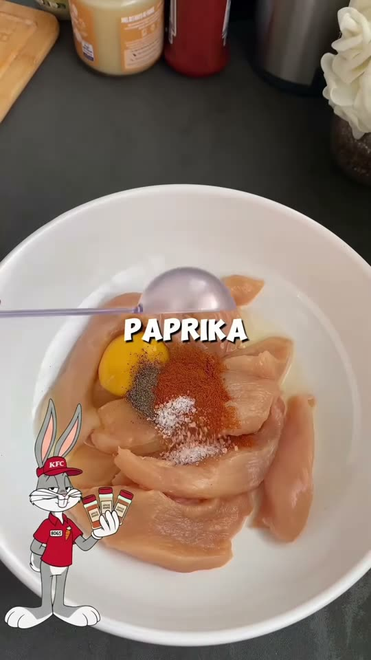
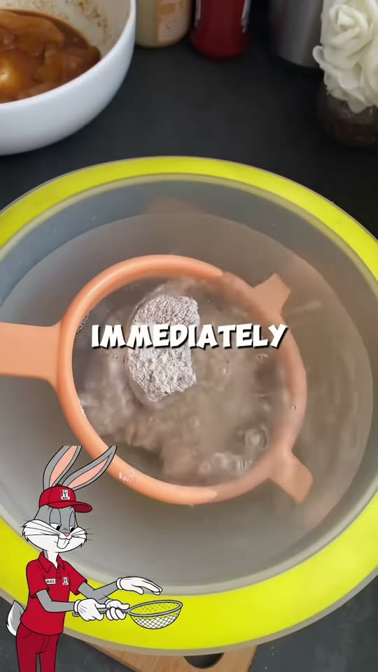
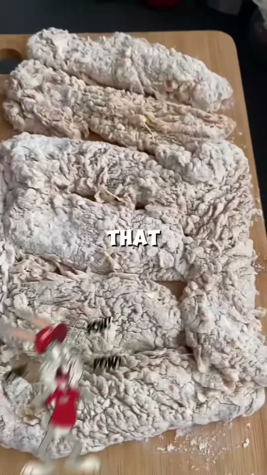

# Fâșii de pui crocante — *chicken tenders* 🇺🇸
**4 porții · Pregătire 20 min · Gătire 25 min · Total aproximativ 45 min · Ușor**

> **Înainte să începi:** pregătește termometrul, o cratiță adâncă, o cutie alimentară cu capac, o sită și un grătar pentru scurgere.
> **Sursa:** videoclipul local „Video by bugs.bunny.cooks.mp4”, atribuit lui **bugs.bunny.cooks** după numele fișierului. Rețeta a fost extrasă din vorbire și cadre; linkul postării și platforma nu sunt cunoscute. Clipul precizează **1 ou** și scufundarea în apă rece timp de **1 secundă**. Toate celelalte cantități, numărul de porții, temperaturile și duratele sunt **orientative**, nu măsurători ale autorului. Afirmațiile despre rețeta secretă KFC și despre experiența de angajat nu sunt verificate. Sosul nu este explicat.

*Foto și toate cadrele: bugs.bunny.cooks, din videoclipul local furnizat; linkul original nu a fost oferit.*

## Povestea
- **Origini:** Este o adaptare de pui prăjit în stil american. Istoria oficială KFC plasează începuturile afacerii lui Sanders în Kentucky ([KFC](https://global.kfc.com/our-history)).
- **Cum a evoluat:** Clipul folosește fâșii dezosate și ou, în timp ce metoda istorică a mărcii presupunea prăjire sub presiune.
- **Curiozitate:** KFC vorbește despre un amestec de unsprezece condimente; aici sunt numite doar sarea, piperul și boiaua. Este o interpretare pentru acasă.

## Sfaturi ca de la bunica 👵
Nu am găsit sfaturi atribuite unei bunici anume; cele de mai jos sunt recomandări practice, cu surse.
- **[confirmat de mai multe surse]** Lasă spațiu între bucăți ca să nu răcești uleiul (Chef Dennis; The Seasoned Mom).
- **[confirmat de mai multe surse]** Scurge pe grătar pentru o crustă crocantă și dedesubt (Chef Dennis; The Cozy Cook).
- **[confirmat de mai multe surse]** Acoperă bine toate laturile (cele trei rețete comparate).
- **Tehnica autorului:** agită în făină, scufundă o secundă în apă, apoi agită din nou în făină (clip, 14–29 s). Această scufundare exactă nu este confirmată independent de rețetele comparate.

## Ingrediente (4 porții)
### Pui și amestec cu ou
- [ ] **600 g piept de pui**, tăiat în fâșii de aproximativ 2 cm grosime *(orientativ)*
- [ ] **1 ou** *(din clip)*
- [ ] **4 g sare fină** *(orientativ)*
- [ ] **2 g boia dulce** *(orientativ)*
- [ ] **1 g piper negru măcinat** *(orientativ)*
### Crustă și prăjire
- [ ] **300 g făină albă** *(orientativ; pentru acoperire, nu se consumă toată)*
- [ ] **2 g boia dulce** *(orientativ)*
- [ ] **3 g sare fină** *(orientativ)*
- [ ] **1 litru apă potabilă rece**, într-un bol separat *(orientativ; se aruncă după folosire)*
- [ ] **1 litru ulei neutru pentru prăjit** *(cantitate orientativă de cumpărat; folosește cât trebuie pentru un strat de 3–4 cm într-o cratiță adâncă, potrivit de îngustă, umplută cel mult pe jumătate)*

**Alergeni:** ou și grâu/gluten. Cantitățile nu includ sos.

## Ustensile
Cratiță adâncă, cu fund gros; termometre pentru ulei și carne; clește; cutie alimentară etanșă, suficient de încăpătoare; sită care încape în bol; grătar deasupra unei tăvi. Nu prăji sub presiune acasă.

## Plan / pregătire
- Taie și cântărește totul. Ține puiul crud la frigider până îl folosești; nu îl spăla.
- Pregătește amestecul de făină înainte să atingi carnea. Pune bolul cu apă departe de aragaz.
- Rezervă aproximativ 20 de minute pentru pregătire și acoperire, apoi 3 tranșe de circa 6–8 minute. Clipul nu cere marinare îndelungată.

## Pași
1. [ ] Amestecă **600 g fâșii de pui** cu **1 ou**, **4 g sare**, **2 g boia** și **1 g piper**. *Toate bucățile trebuie să fie lucioase și condimentate uniform.*

2. [ ] Combină **300 g făină**, **2 g boia** și **3 g sare** în cutia cu capac.
3. [ ] Pune fâșiile în cutie, în tranșe; închide bine și agită până când *nu mai rămân zone neacoperite*. Mută în sită și scutură făina în exces.

4. [ ] Scufundă sita în bolul cu **1 litru apă rece** pentru **1 secundă**, apoi ridic-o imediat și lasă picăturile să se scurgă. *Umezește primul strat; nu lăsa la înmuiat.* Ține apa departe de uleiul încins.

⏱ **Cronometru: 1 secundă** — scufundă și ridică imediat (din clip).

5. [ ] Pune fâșiile înapoi în **aceeași făină condimentată de la pasul 2** și agită din nou. *Suprafața trebuie să aibă mici creste și să fie acoperită complet.* Păstrează la frigider bucățile crude care așteaptă. Aruncă făina și apa contaminate după terminarea acoperirii.

6. [ ] Încălzește **uleiul din cantitatea de 1 litru**, într-un strat de **3–4 cm**, la **175°C** *(orientativ; Chef Dennis folosește aproximativ 175°C)*. Lasă spațiu suficient în vas; nu testa uleiul cu apă. Lasă apa în exces să se scurgă înainte de prăjire.
7. [ ] Coboară câteva fâșii în ulei cu cleștele. Prăjește prima parte **3–4 minute** *(orientativ)*, reglând focul pentru a păstra circa **175°C**. *Crusta trebuie să se fixeze și să devină aurie; nu înghesui bucățile.*

⏱ **Cronometru: 3–4 min** — prima parte aurie.

8. [ ] Întoarce și prăjește încă **3–4 minute** *(orientativ)*. Verifică **74°C în centrul celei mai groase bucăți** și prelungește dacă este nevoie. *Culoarea aurie nu dovedește singură că puiul este sigur de consumat.* Între timp, pregătește un platou curat.

⏱ **Cronometru: 3–4 min** — a doua parte aurie, 74°C în interior.

9. [ ] Scurge pe grătar. Adu uleiul din nou la **175°C** înainte de tranșa următoare; repetă pașii 7–8. Servește imediat.

*Toate fotografiile de mai sus: cadre din videoclipul bugs.bunny.cooks furnizat.*

## Cronometre pe scurt
| Pas | Durată | Reper |
|---|---|---|
| 4 | 1 secundă | Ridică imediat din apă |
| 7 | 3–4 min pe tranșă | Prima parte aurie |
| 8 | 3–4 min pe tranșă | Crustă aurie; 74°C în interior |

## Dacă ceva nu iese
- Crustă palidă și uleioasă: readu uleiul la 175°C și prăjește mai puține bucăți odată.
- Exterior rumen, interior crud: redu puțin focul și continuă până la 74°C; data viitoare taie mai subțire.
- Crusta se desprinde: scurge mai bine apa și nu întoarce până nu se fixează primul strat.
- Făină rămasă uscată: verifică dacă scufundarea umezește primul strat și dacă al doilea acoperă toate laturile.

## Lista de cumpărături
- [ ] **Carne:** 600 g piept de pui *(orientativ)*
- [ ] **Lactate / Ouă:** 1 ou
- [ ] **Cămară / Condimente:** 300 g făină; 4 g boia; 7 g sare fină; 1 g piper; 1 litru ulei pentru prăjit *(toate orientative)*
- **Verifică dacă ai:** 1 litru apă potabilă rece *(orientativ)*. Uleiul reprezintă necesarul pentru baie, nu cantitatea absorbită.

## Surse comparate
Videoclipul local este baza; rețetele americane în engleză verifică tehnica, fără a înlocui amestecul autorului.

| Sursă | Autor | De ce a contat | Detaliu |
|---|---|---|---|
| [The Cozy Cook](https://thecozycook.com/fried-chicken-tenders/) | Stephanie | Explică prăjirea | 175–190°C; folosește albuș și făină cu pesmet |
| [The Seasoned Mom](https://www.theseasonedmom.com/fried-chicken-tenders/) | Blair Lonergan | Timpi și sfaturi pentru tranșe | Circa 190°C; 3–4 min pe parte |
| [Ask Chef Dennis](https://www.askchefdennis.com/crispy-fried-chicken-tenders/) | Dennis Littley | Acoperire dublă și temperaturi | Circa 175°C; 3–4 min pe parte |

**Alegerea cantităților:** The Seasoned Mom folosește circa 180 g făină la 907 g pui (~119 g la 600 g); Chef Dennis circa 360 g la 454 g (~476 g la 600 g), calculând 120 g făină/cană. The Cozy Cook indică numărul piepților, fără greutate, deci nu se poate normaliza corect. Mijlocul celor două valori comparabile este circa 298 g: rotunjit la **300 g făină disponibilă pentru acoperire**. Straturile diferă; este un necesar practic, nu o proporție optimă verificată. Păstrăm oul din clip și omitem laptele bătut și pesmetul celorlalte surse. Alegem temperatura mai mică pentru rumenirea treptată a crustei duble; timpul este orientativ, termometrul decide. Cantitățile de sare, boia și piper sunt puncte de pornire editoriale, nu un consens al surselor.

**Verificarea linkurilor:** rețetele comparate și CDC au putut fi citite prin instrumentul web, dar au răspuns cu HTTP 403 la curl local pe 2026-11-13. Am păstrat referințele citite, fără a inventa adrese alternative. KFC a răspuns cu 200. Linkul original al autorului nu este cunoscut.

## Trucuri și detalii
- Lasă prima parte să se fixeze înainte de a mișca bucățile (The Seasoned Mom).
- Taie fâșii uniforme și scurge pe grătar (The Cozy Cook).
- Două straturi de făină dau o crustă mai groasă (Chef Dennis); etapa de o secundă în apă provine precis din acest clip.

## Servire, păstrare, reîncălzire
Servește cu salată coleslaw, cartofi prăjiți și un sos ales separat; alături merge o limonadă (The Seasoned Mom). Sosul roz-portocaliu din clip nu este identificat. Pune la frigider în cel mult **2 ore**, la **maximum 4°C**; păstrează **2–3 zile**. Congelează până la **2 luni**. Reîncălzește pe grătar în cuptor la **200°C**, verificând de la aproximativ **10 minute**, până la **74°C în centru**; nu acoperi cât este fierbinte. Păstrarea și reîncălzirea sunt adaptate după The Seasoned Mom și The Cozy Cook; igiena și temperaturile sigure: [CDC](https://www.cdc.gov/food-safety/prevention/). Făina folosită, amestecul cu ou și apa de scufundare sunt contaminate cu pui crud.

## Variante și înlocuiri
- **Comparație în stil sudist:** Chef Dennis și The Seasoned Mom folosesc lapte bătut la marinare; în clip nu apare.
- **Adaptare:** usturoiul sau ardeiul iute schimbă aroma; aici nu sunt specificate.

## Grad de încredere
Încredere ridicată în succesiunea rostită și în folosirea unui ou; moderată în cantitățile adăugate. Nu sunt confirmate identitatea cu KFC, postarea originală, formula sosului sau un rezultat testat în bucătărie.
