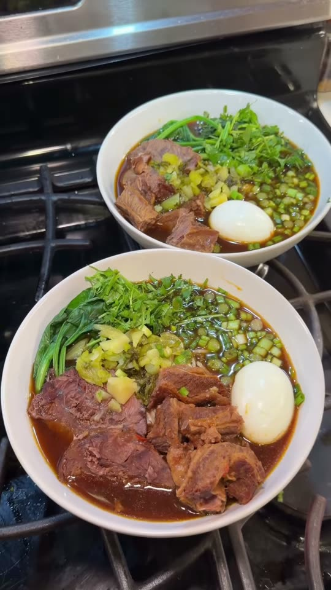
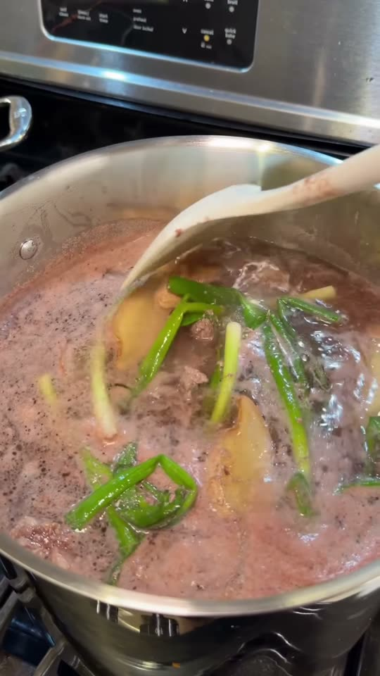
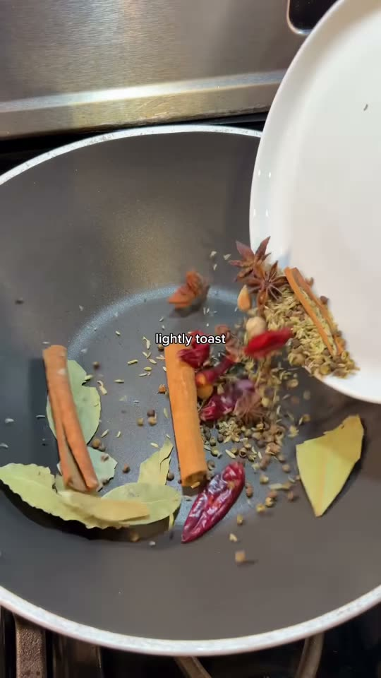
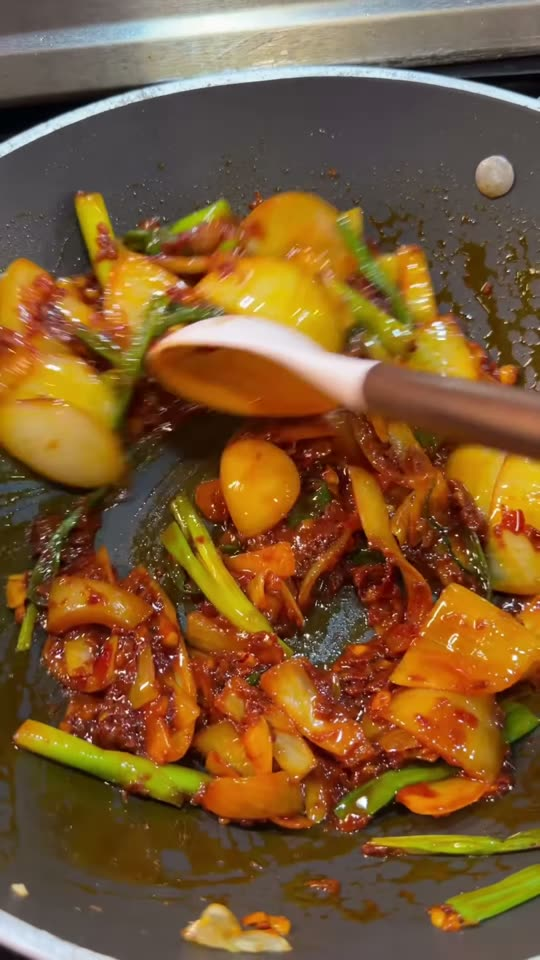
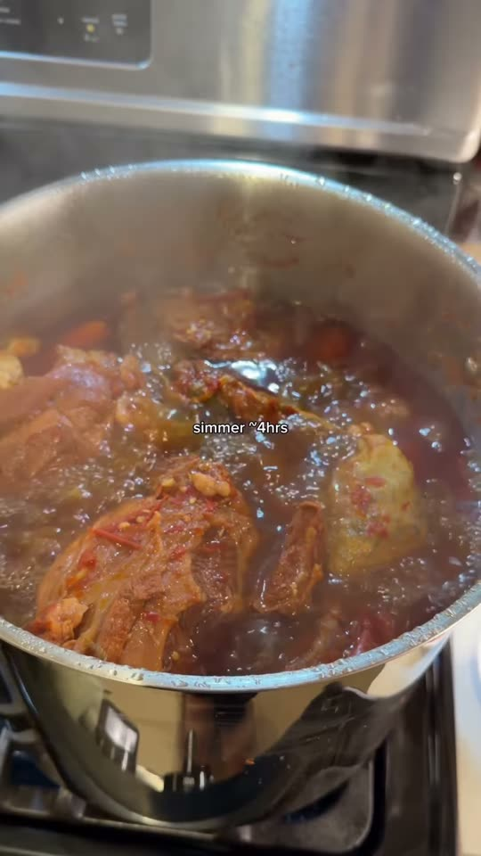
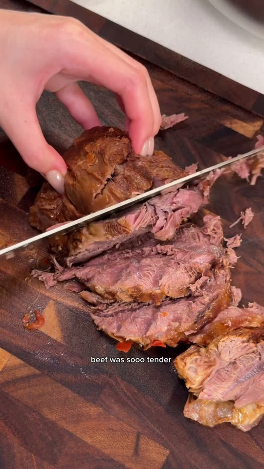
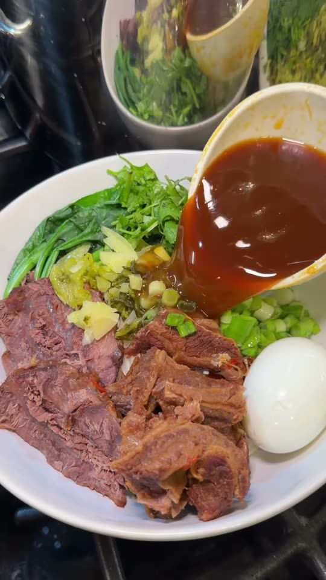

# Chinese braised beef noodle soup — 红烧牛肉面
**About 10 servings (estimate) · Prep 40 min · Simmer about 4 h · Total about 5 h · Medium**

> **Before you start:** use a stockpot with ample headroom, approximately 10–12 litres; divide between two pots if needed. This is the creator's large batch. All measurements below use grams, millilitres and Celsius, suitable for a Romanian kitchen.
> **Source:** Instagram video by **scallion__baby**, supplied as “Video by scallion__baby.mp4”, plus the creator's Instagram caption supplied by the user. Method read from frames and on-screen text; the transcript contains mostly tasting remarks. [Creator's matching Substack article](https://emilyywang.substack.com/p/chinese-braised-beef-noodle-soup) is subscription-gated beyond its introduction; the full article was not read. No original Instagram post URL was supplied. Quantities marked **(typical)** fill gaps; approximate solid conversions are marked **(approx.)**. Serving count is an estimate because four shanks have no stated weight.

*Photo and every step frame: scallion__baby, user-supplied Instagram video. Creator link above; original reel URL unavailable.*

## The story
- **Origins:** Chinese red-braising, *hóngshāo*, gives this soup its savory, dark broth. The creator calls it Chinese beef noodle soup; no specific hometown is established here.
- **How it evolved:** Related Taiwanese beef noodles grew through postwar migration and military-family communities, combining different regional cooking traditions (Michelin, Chinese-language article).
- **Fun fact:** Taiwanese red-braised bowls vary widely between shops; there is no single mandatory spice blend (Michelin). Pronounce the dish roughly **hong-shao nyoh-roh myen**.

## Grandma's tips 👵
- **[tradition]** A grandmother-taught iCook recipe works without a purchased braising sachet; a commercial packet is not essential (島田ようよう).
- **[confirmed by several sources]** Fry the doubanjiang until its aroma opens and oil turns red (Amanda; Laura's Kitchen).
- **[confirmed by several sources]** Keep the noodles separate until serving (Ytower; Amanda).
- **[confirmed by several sources]** Judge the beef by tenderness, not color alone (Amanda; Laura's Kitchen). The creator's whole shanks take much longer than their small chunks.

## Ingredients — full batch, about 10 bowls
### Beef and vegetables
- [ ] **4 beef shanks**, as specified by the creator; weight and exact cut not supplied. Frames show large whole pieces, not clearly identifiable bone-in cross-cut steaks. Ask for beef shank / *rasol de vită*, preferably whole boneless shank muscles to match the footage; weigh what you buy.
- [ ] **1,360 g beef rib fingers**, boneless meat between ribs; Romanian butcher description: *carne dezosată dintre coastele de vită*. Not 1,360 g bone-in ribs.
- [ ] **3 tomatoes**, chopped
- [ ] **2 carrots**, thickly sliced
- [ ] **1 onion**, chopped
- [ ] **5 garlic cloves**, chopped
- [ ] **40 g ginger (typical)** for the caption's unweighed knob: split **10 g for blanching + 30 g for braising**
- [ ] **3 scallions**: **1 for blanching + 2 for braising** (split follows the video; caption gives 3 total)
### Seasoning and liquid
- [ ] **60 ml spicy doubanjiang** / *pastă fermentată picantă de fasole lată*, measured by volume; do not assume 60 ml weighs 60 g
- [ ] **120 ml regular/light Chinese soy sauce**
- [ ] **120 ml dark Chinese soy sauce**, *老抽*; distinct from regular soy sauce
- [ ] **30 ml oyster sauce**
- [ ] **25 g rock sugar (approx.)**, crushed; spoon-to-weight conversion varies with crystal size
- [ ] **60 ml cooking rice wine**: **15 ml for blanching + 45 ml for braising (typical allocation)**; the caption gives only the total
- [ ] **30 ml neutral oil (typical)** for frying aromatics; informed by Amanda's use of oil, not stated in the caption
- [ ] **4,000 ml water to start the braise (typical)**, or enough to cover the meat in your pot; more hot water as needed. Separate blanching and noodle water, as needed, is discarded.
### Spice bag — creator's blend
- [ ] **4 star anise**
- [ ] **2 Chinese black cardamom pods / 草果 (cao guo)**, not green cardamom
- [ ] **2 cinnamon sticks**
- [ ] **3 cloves**
- [ ] **4 bay leaves**
- [ ] **4 dried chilies**
- [ ] **6 g Sichuan peppercorns (approx.)**
- [ ] **6 g fennel seeds (approx.)**
### Assembly — amounts below are typical, not supplied by the creator
- [ ] **1,000 g fresh wheat noodles (typical)**; cook more if appetites or pack directions call for it
- [ ] **500 g spinach (typical)**
- [ ] **3 additional scallions (typical)**, finely sliced
- [ ] **20 g cilantro (typical)**, chopped; optional
- [ ] **200 g ready-to-eat pickled mustard greens / 酸菜 (typical)**, chopped; optional
- [ ] **10 eggs (typical)**; optional. Creator serves soft-boiled eggs; fully set eggs are the safer alternative.
- [ ] **50 ml chili oil (typical)**; optional, visible at tasting

**Allergens:** wheat/gluten, soy, shellfish in oyster sauce, optional egg; check doubanjiang and noodle labels. Asian-shop ingredients: doubanjiang, both soy sauces, cao guo, Sichuan pepper and pickled mustard greens. Do not replace cao guo with green cardamom as though the flavor were equivalent; omit it if unavailable and label the result an adaptation.

## Equipment
Large stockpot(s), frying pan, spice bag or tea filter, colander, fine sieve, tongs, ladle, clean board, noodle pot. **Four shanks vary hugely in weight:** check capacity before starting; never fill the pot to the rim.

## Plan / mise en place
- Chop **3 tomatoes, 2 carrots, 1 onion, 5 garlic cloves**. Split **40 g ginger**, **3 cooking scallions**, and **60 ml wine** as listed.
- Measure both soy sauces separately. Set out all spices and the bag.
- For make-ahead, cook beef and broth first; chill promptly in small containers. Cook noodles and spinach only when serving.
- Allow around **5 hours**; rib fingers may become tender before the shanks and can be removed individually.

## Steps
1. [ ] Put **4 shanks**, **1,360 g rib fingers**, **10 g ginger**, **1 scallion** and **15 ml cooking wine** in the pot; cover with cold water **as needed**. Bring to a boil and blanch until *a gray foam forms*, roughly **5 minutes after boiling (typical)**.

⏱ **Timer: 5 min after boiling** — surface scum forms; this is not the main cooking stage.

2. [ ] Drain and discard the blanching liquid and aromatics. Carefully rinse scum from the blanched beef without splashing; clean the pot. This follows the clip; do not rinse raw meat around the kitchen.
3. [ ] Gently toast **4 star anise, 2 cao guo pods, 2 cinnamon sticks, 3 cloves, 4 bay leaves, 4 dried chilies, 6 g Sichuan peppercorns and 6 g fennel seeds** in a dry pan for **1–2 minutes (typical)**. *Stop when fragrant, before anything blackens.* Transfer to the spice bag and secure.

⏱ **Timer: 1–2 min** — fragrant, not scorched.

4. [ ] Heat **30 ml oil** over medium heat. Soften **1 onion, 5 garlic cloves and the remaining 2 cooking scallions** for **3–5 minutes (typical)**. Stir in **60 ml doubanjiang**, cooking gently for **1–2 minutes (typical)** until *the oil turns red and the paste smells toasted*.

⏱ **Timer: 3–5 min**, then **1–2 min** for the paste.

5. [ ] Stir in **3 tomatoes** and cook **3–5 minutes (typical)**, until *they soften and release juice*.

⏱ **Timer: 3–5 min** — tomatoes juicy.

6. [ ] Return **all blanched beef from step 2** to the clean pot. Add **the fried mixture from steps 4–5**, **2 carrots**, **30 g remaining ginger**, **the whole spice bag**, **120 ml regular soy**, **120 ml dark soy**, **30 ml oyster sauce**, **25 g rock sugar**, **45 ml remaining wine**, and **4,000 ml water initially**, adjusting to just cover the meat. Keep safe headroom; divide between pots if necessary.
7. [ ] Bring to a boil, then reduce to a **gentle simmer**, partly covered. Cook **about 4 hours**, as shown in the video. Check liquid every **30–45 minutes** and top up with hot water as needed. Start checking rib fingers around **2 hours**; remove any pieces that are already tender. *A skewer should slide easily into the shank and connective tissue should soften.* Extend if still chewy.

⏱ **Timer: 2 h** — first tenderness check; then check every 30 min, aiming for about 4 h total.

8. [ ] Lift out **all tender beef**. Skim excess fat from the broth and strain out **the spice bag and cooked aromatics**. Taste: these soy quantities make a concentrated base. Add hot water **to taste**, not more soy by default. Slice shanks across the grain when cool enough to handle; cut rib fingers into serving pieces.

9. [ ] If using **10 optional eggs**, boil separately: approximately **7 minutes (typical)** for soft centers or **10–12 minutes (typical)** for fully set yolks, then cool and peel. Soft eggs carry more risk; use fully cooked eggs for vulnerable diners.

⏱ **Timer: choose 7 min OR 10–12 min** — optional egg doneness.

10. [ ] Cook **1,000 g fresh noodles** in fresh boiling water **according to the package**, in batches; drain. Separately blanch **500 g spinach** for roughly **30–60 seconds (typical)** until *wilted and bright green*.

⏱ **Timer: package noodle time; spinach 30–60 seconds**.

11. [ ] Divide **all noodles, spinach and beef** among about **10 bowls**. Add hot broth, **3 sliced garnish scallions**, optional **20 g cilantro**, **200 g pickled mustard greens**, **10 eggs**, and **50 ml chili oil**, divided evenly. Begin with a little pickle and chili oil, then adjust.

*All step photos: scallion__baby, supplied Instagram video.*

## Timer cheat-sheet
| Stage | Duration | Cue |
|---|---|---|
| Blanch | About 5 min after boiling | Gray scum |
| Toast | 1–2 min | Fragrant spices |
| Aromatics / paste | 3–5 / 1–2 min | Soft onion / red oil |
| Tomatoes | 3–5 min | Juicy |
| Braise | About 4 h; check from 2 h | Skewer enters easily |
| Optional eggs | 7 OR 10–12 min | Soft OR set yolks |
| Noodles / spinach | Package / 30–60 sec | Cooked noodles / wilted greens |

## If it goes wrong
- **Tough beef:** continue simmering; shank needs collagen-softening time, not harder boiling.
- **Salty broth:** dilute a ladleful to taste first, then apply that ratio to the pot. Pickles add more salt.
- **Bitter spices:** discard a burned spice batch before it enters the broth.
- **Greasy surface:** skim or chill the broth promptly and remove the solid fat later.
- **Noodles swollen in storage:** store them separately; cook fresh portions for each meal.

## Grocery list
- [ ] **Meat:** 4 beef shanks (weight unknown); 1,360 g boneless rib fingers
- [ ] **Produce:** 3 tomatoes; 2 carrots; 1 onion; 5 garlic cloves; 40 g ginger *(typical)*; **6 scallions total** (3 cooking + 3 garnish, garnish amount typical); 500 g spinach *(typical)*; optional 20 g cilantro *(typical)*
- [ ] **Eggs:** optional 10 eggs *(typical)*
- [ ] **Pantry:** 1,000 g fresh noodles *(typical)*; 30 ml neutral oil *(typical)*; 25 g rock sugar *(approx.)*; 60 ml rice cooking wine
- [ ] **Asian / Specialty:** 60 ml spicy doubanjiang; 120 ml regular soy; 120 ml dark soy; 30 ml oyster sauce; 4 star anise; 2 cao guo; 2 cinnamon sticks; 3 cloves; 4 bay leaves; 4 dried chilies; 6 g Sichuan peppercorns and 6 g fennel seeds *(both approx.)*; optional 200 g pickled mustard greens and 50 ml chili oil *(both typical)*
- **Check you have:** 4,000 ml braising water initially *(typical)*, plus water for blanching, noodles and top-ups; spice bag. Do not add salt automatically.

## Sources compared
| Source | Role | Detail |
|---|---|---|
| User-supplied Instagram caption and video, scallion__baby | Primary base | Exact counts and sauce volumes; frame at 45 s says about 4 h |
| [Creator's Substack](https://emilyywang.substack.com/p/chinese-braised-beef-noodle-soup) | Attribution only | Introduction visible; full recipe subscription-gated, not read |
| [Amanda — 紅燒牛肋條、牛肉麵](https://amanda.tw/archives/28964) | Experienced Taiwanese cook, 3/3 | Fry paste, skim fat; 1,800–2,000 ml water for 1,500 g rib fingers |
| [Ytower — 紅燒牛肉麵](https://www.ytower.com.tw/recipe/A01-090) | Established publisher, 2/3 | Blanch beef; cover with broth; noodles cooked separately |
| [Laura's Kitchen — 紅燒牛肉](https://icook.tw/recipes/449935) | Named cook, 3/3 | Tomato and doubanjiang; chunked beef cooks faster |

**Reconciliation:** This is a creator recipe, so its caption quantities take priority over a median rewrite. Amanda's water ratio is approximately **1,200–1,333 ml per kg beef**; other comparison recipes use enough water to cover. With four unweighed shanks, a precise normalized ratio or serving count cannot be calculated. **4,000 ml is a practical starting estimate**, adjusted to pot geometry, beef weight and taste. Native recipes use shorter times for chunks; keep the video's **about 4 hours for large pieces** and remove tender rib fingers early. No comparison source establishes this creator's exact spice mix. The cooked shank may resemble tongue when sliced; the caption identifies it as shank, not tongue.

## Tips & tricks
- The creator toasts spices, bags them, skims oil and strains aromatics; these details are visible in the footage.
- Amanda's practical trick: remove chilled surface fat more easily; chill safely in portions, never leave a large pot out overnight.
- Laura's recipe confirms that broth can be diluted before becoming noodle soup. Taste before adding more seasoning.

## Serve, store, reheat
Serve as a complete meal with mustard greens and optional chili oil; unsweetened tea works alongside. Divide leftover beef and broth into shallow containers and refrigerate within **2 hours**; keep the fridge at **4°C or below**. For this card, use within **2 days** or freeze meal-size portions for **up to 2 months (practical storage limit)**. Reheat broth to a boil and beef until steaming hot throughout; cook noodles fresh. The [Taiwan FDA](https://www.fda.gov.tw/tc/newsContent.aspx?cid=4&id=31422) advises prompt chilling, thorough reheating and avoiding repeated heating. Fully cooked eggs are the safer alternative to the clip's soft eggs.

## Regional variants & substitutions
- **Related Taiwanese style:** tomato, doubanjiang and mustard greens are familiar in red-braised beef noodles; this does not establish the creator's nationality or a uniquely Taiwanese origin for her recipe.
- **Clear-broth versions:** a different family; do not simply omit all the dark seasonings and call this unchanged.
- **Practical adaptation:** boneless beef chuck can replace rib fingers by weight; texture and timing change. Omit unavailable cao guo rather than secretly replacing it with green cardamom.

## Confidence note
High confidence in user-supplied caption amounts and visible sequence; estimates remain for water, garnish, serving yield and unweighed ingredients. Exact shank weight and original reel URL are unknown. Full paid Substack recipe was not accessed.
