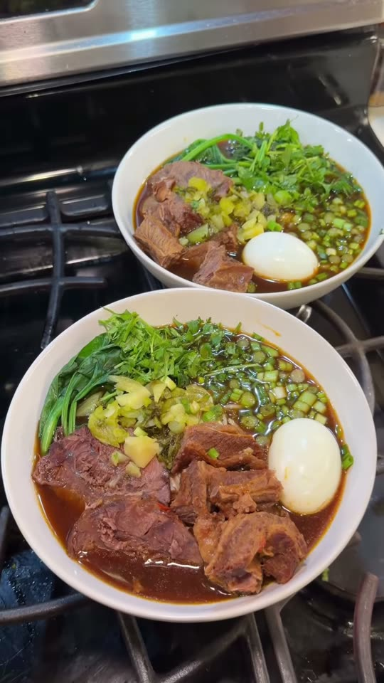
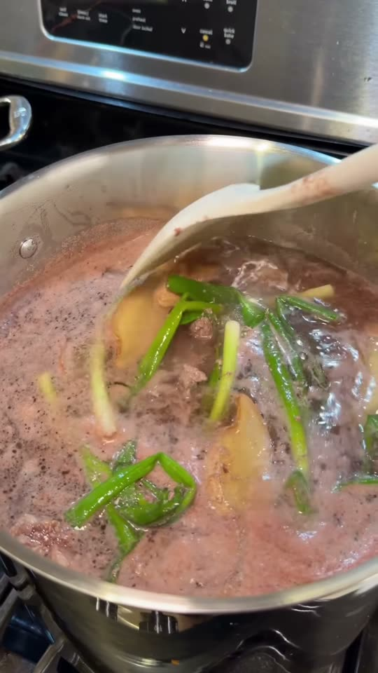
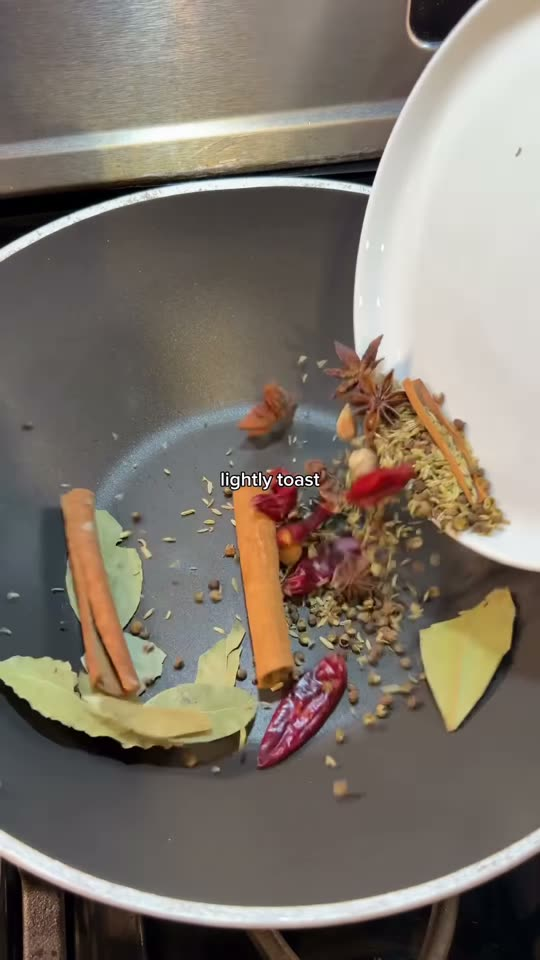
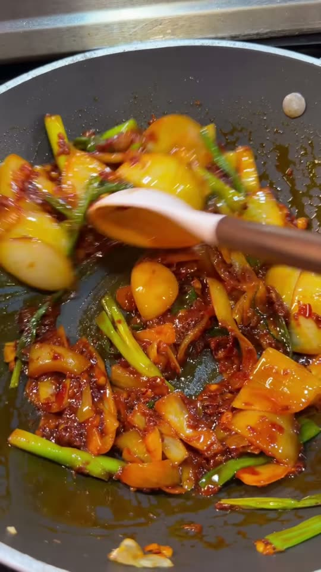
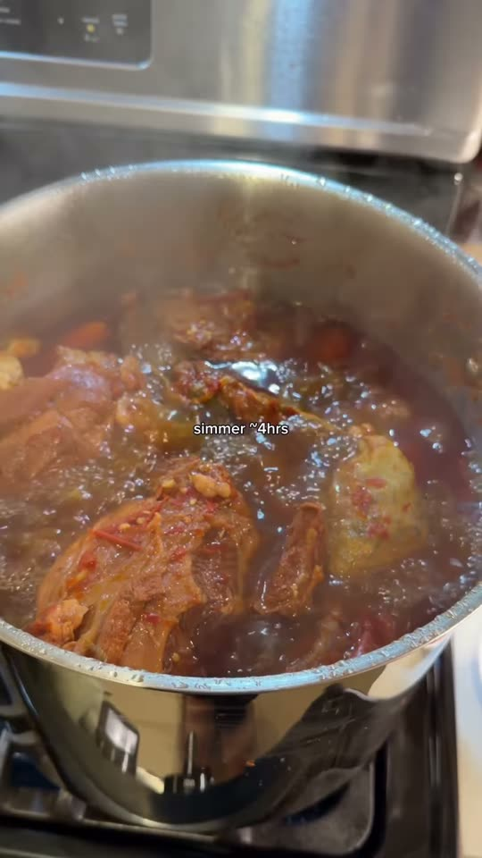
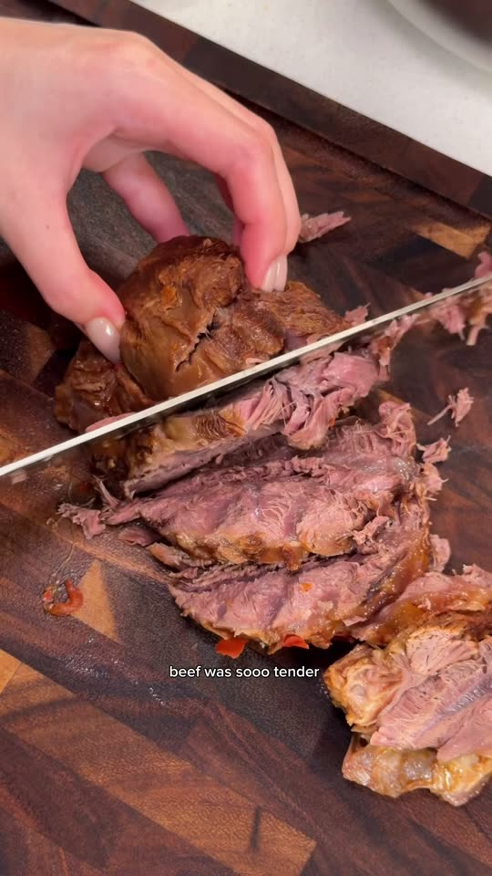
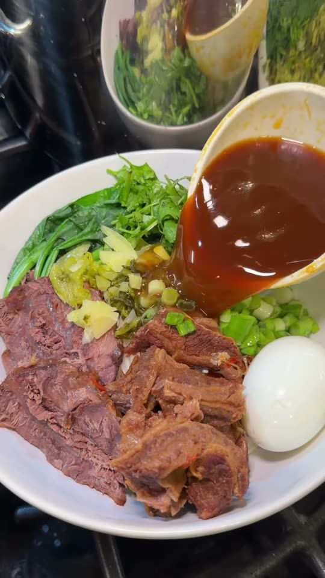

# Supă chinezească de vită cu tăiței — 红烧牛肉面
**Circa 10 porții (estimare) · Pregătire 40 min · Fierbere lentă circa 4 ore · Total circa 5 ore · Dificultate medie**

> **Înainte să începi:** pregătește o oală încăpătoare, de aproximativ 10–12 litri, cu spațiu liber suficient; împarte în două oale dacă este nevoie. Este cantitatea mare a autoarei. Măsurătorile sunt în grame, mililitri și grade Celsius, pentru bucătăria din România.
> **Sursa:** videoclipul Instagram al autoarei **scallion__baby**, furnizat ca „Video by scallion__baby.mp4”, plus descrierea Instagram trimisă de utilizator. Metoda a fost extrasă din cadre și textele afișate; transcrierea conține mai ales reacțiile de la degustare. [Articolul corespunzător de pe Substack](https://emilyywang.substack.com/p/chinese-braised-beef-noodle-soup) cere abonament după introducere; rețeta integrală de acolo nu a fost citită. Linkul postării Instagram nu a fost oferit. Cantitățile **(orientative)** completează lipsurile; conversiile de greutate inexacte sunt marcate **(aprox.)**. Porțiile sunt estimate, deoarece cele patru bucăți de rasol nu au greutate precizată.

*Foto și toate cadrele: scallion__baby, din videoclipul Instagram furnizat. Linkul autoarei este mai sus; adresa originală a reelului nu este cunoscută.*

## Povestea
- **Origini:** Tehnica chinezească *hóngshāo*, înăbușirea în sos închis, dă supei gustul intens și culoarea. Autoarea o numește supă chinezească de vită cu tăiței; nu este stabilită o localitate de origine.
- **Cum a evoluat:** Preparatele înrudite din Taiwan s-au dezvoltat prin migrația de după război și comunitățile familiilor de militari, reunind tradiții regionale diferite (Michelin, articol în chineză).
- **Curiozitate:** Supele taiwaneze cu vită diferă mult de la un local la altul; nu există un singur amestec obligatoriu de condimente (Michelin). Pronunție aproximativă: **hong-șao niu-rou mien**.

## Sfaturi ca de la bunica 👵
- **[tradiție]** O rețetă iCook învățată de la bunică se face fără plic comercial pentru înăbușire; nu este obligatoriu să cumperi un amestec gata făcut (島田ようよう).
- **[confirmat de mai multe surse]** Călește doubanjiang până devine aromat și colorează uleiul în roșu (Amanda; Laura's Kitchen).
- **[confirmat de mai multe surse]** Fierbe tăițeii separat, aproape de servire (Ytower; Amanda).
- **[confirmat de mai multe surse]** Verifică frăgezimea, nu doar culoarea cărnii (Amanda; Laura's Kitchen). Rasolul întreg din clip cere mult mai mult timp decât cuburile lor mici.

## Ingrediente — cantitatea întreagă, circa 10 boluri
### Carne și legume
- [ ] **4 bucăți de rasol de vită**, conform autoarei; greutatea și tăietura exactă nu sunt precizate. Cadrele arată bucăți mari, întregi, fără a putea identifica sigur felii transversale cu os. Pentru a semăna cu imaginile, cere preferabil mușchi întregi de rasol dezosat; cântărește ce cumperi.
- [ ] **1.360 g carne dezosată dintre coastele de vită**, *beef rib fingers*. Nu 1.360 g coaste cu os.
- [ ] **3 roșii**, tăiate
- [ ] **2 morcovi**, felii groase
- [ ] **1 ceapă**, tăiată
- [ ] **5 căței de usturoi**, tocați
- [ ] **40 g ghimbir (orientativ)** pentru bucata necântărită din descriere: **10 g pentru opărire + 30 g pentru fierberea principală**
- [ ] **3 fire de ceapă verde**: **1 pentru opărire + 2 pentru călit** (împărțire după clip; descrierea dă 3 în total)
### Sosuri și lichid
- [ ] **60 ml doubanjiang picant**, pastă fermentată de fasole lată; măsurată ca volum, nu presupune că 60 ml cântăresc 60 g
- [ ] **120 ml sos de soia chinezesc obișnuit/light**
- [ ] **120 ml sos de soia chinezesc închis/dark**, *老抽*; diferă de sosul obișnuit
- [ ] **30 ml sos de stridii**
- [ ] **25 g zahăr candel (aprox.)**, mărunțit; conversia depinde de mărimea cristalelor
- [ ] **60 ml vin de orez pentru gătit**: **15 ml pentru opărire + 45 ml pentru fierberea principală (împărțire orientativă)**; descrierea dă numai totalul
- [ ] **30 ml ulei neutru (orientativ)** pentru călit; folosirea uleiului este susținută de Amanda, cantitatea nu apare în descriere
- [ ] **4.000 ml apă pentru începutul fierberii principale (orientativ)** sau cât să acopere carnea în oala ta; apă fierbinte suplimentară după nevoie. Apa separată pentru opărire și tăiței se aruncă.
### Săculețul de condimente — amestecul autoarei
- [ ] **4 bucăți de anason stelat**
- [ ] **2 păstăi de cardamom negru chinezesc / 草果 (cao guo)**, nu cardamom verde
- [ ] **2 batoane de scorțișoară**
- [ ] **3 cuișoare**
- [ ] **4 foi de dafin**
- [ ] **4 ardei iuți uscați**
- [ ] **6 g piper Sichuan (aprox.)**
- [ ] **6 g semințe de fenicul (aprox.)**
### Pentru boluri — cantități orientative, neprecizate de autoare
- [ ] **1.000 g tăiței proaspeți din grâu (orientativ)**; fierbe mai mulți dacă porțiile sau ambalajul cer
- [ ] **500 g spanac (orientativ)**
- [ ] **3 fire suplimentare de ceapă verde (orientativ)**, feliate fin
- [ ] **20 g coriandru verde (orientativ)**, tocat; opțional
- [ ] **200 g frunze de muștar murate, gata de consum / 酸菜 (orientativ)**, tocate; opțional
- [ ] **10 ouă (orientativ)**; opțional. Autoarea servește ouă moi; cele cu gălbenuș complet închegat sunt alternativa mai sigură.
- [ ] **50 ml ulei cu ardei iute (orientativ)**; opțional, vizibil la degustare

**Alergeni:** grâu/gluten, soia, moluște în sosul de stridii, ou opțional; verifică etichetele pastei și tăițeilor. La magazin asiatic: doubanjiang, cele două sosuri de soia, cao guo, piper Sichuan și frunze de muștar murate. Nu înlocui cao guo cu cardamom verde ca și cum ar avea aceeași aromă; dacă nu găsești, omite-l și consideră rezultatul o adaptare.

## Ustensile
Oală mare sau două oale, tigaie, săculeț pentru condimente ori filtru de ceai, strecurătoare, sită fină, clește, polonic, tocător curat, oală pentru tăiței. **Patru bucăți de rasol pot varia mult ca greutate:** verifică volumul înainte; nu umple oala până sus.

## Plan / pregătire
- Taie **3 roșii, 2 morcovi, 1 ceapă și 5 căței de usturoi**. Împarte **40 g ghimbir**, **3 fire de ceapă pentru gătit** și **60 ml vin** conform listei.
- Măsoară separat cele două sosuri de soia. Pregătește condimentele și săculețul.
- Pentru pregătire în avans, gătește carnea și supa; răcește repede în recipiente mici. Fierbe tăițeii și spanacul la servire.
- Rezervă circa **5 ore**; carnea dintre coaste se poate frăgezi înaintea rasolului și poate fi scoasă separat.

## Pași
1. [ ] Pune în oală **4 bucăți de rasol**, **1.360 g carne dintre coaste**, **10 g ghimbir**, **1 fir de ceapă verde** și **15 ml vin de orez**; acoperă cu apă rece **cât este nevoie**. Adu la fierbere și opărește până apare *spumă cenușie*, circa **5 minute după clocot (orientativ)**.

⏱ **Cronometru: 5 min după clocot** — apare spuma; nu este fierberea principală.

2. [ ] Scurge și aruncă apa și aromaticele de opărire. Clătește atent spuma de pe carnea opărită, fără să stropești; curăță oala. Așa procedează autoarea; nu spăla carnea crudă stropind bucătăria.
3. [ ] Încălzește blând, într-o tigaie uscată, **4 bucăți de anason stelat, 2 păstăi cao guo, 2 batoane de scorțișoară, 3 cuișoare, 4 foi de dafin, 4 ardei uscați, 6 g piper Sichuan și 6 g fenicul**, circa **1–2 minute (orientativ)**. *Oprește când miros puternic, înainte să se înnegrească.* Mută în săculeț și închide bine.

⏱ **Cronometru: 1–2 min** — aromate, nu arse.

4. [ ] Încălzește **30 ml ulei** la foc mediu. Înmoaie **1 ceapă, 5 căței de usturoi și cele 2 fire rămase de ceapă verde pentru gătit**, circa **3–5 minute (orientativ)**. Adaugă **60 ml doubanjiang** și călește blând **1–2 minute (orientativ)**, până când *uleiul se colorează în roșu, iar pasta devine aromată*.

⏱ **Cronometru: 3–5 min**, apoi **1–2 min** pentru pastă.

5. [ ] Adaugă **3 roșii** și gătește **3–5 minute (orientativ)**, până când *se înmoaie și lasă suc*.

⏱ **Cronometru: 3–5 min** — roșii zemoase.

6. [ ] Pune **toată carnea opărită de la pasul 2** în oala curată. Adaugă **amestecul călit de la pașii 4–5**, **2 morcovi**, **30 g ghimbir rămas**, **săculețul întreg de condimente**, **120 ml soia obișnuită**, **120 ml soia dark**, **30 ml sos de stridii**, **25 g zahăr candel**, **45 ml vin rămas** și, inițial, **4.000 ml apă**, ajustând cât să acopere carnea. Lasă spațiu liber; împarte în două oale dacă este nevoie.
7. [ ] Adu la clocot, apoi redu la o **fierbere foarte blândă**, cu capacul întredeschis. Gătește **circa 4 ore**, ca în clip. Verifică lichidul la **30–45 de minute** și completează cu apă fierbinte după nevoie. Verifică de la **2 ore** carnea dintre coaste și scoate bucățile deja fragede. *O frigăruie trebuie să intre ușor în rasol, iar țesutul conjunctiv să se înmoaie.* Continuă dacă încă este tare.

⏱ **Cronometru: 2 ore** — prima verificare; apoi la 30 min, către circa 4 ore în total.

8. [ ] Scoate **toată carnea fragedă**. Îndepărtează grăsimea în exces de la suprafață și strecoară **săculețul și aromaticele fierte**. Gustă: cantitățile de soia dau o bază concentrată. Adaugă apă fierbinte **după gust**, nu automat mai multă soia. Feliază rasolul perpendicular pe fibre când poate fi manevrat; taie carnea dintre coaste în bucăți pentru servire.

9. [ ] Dacă folosești **10 ouă opționale**, fierbe-le separat: circa **7 minute (orientativ)** pentru gălbenuș moale sau **10–12 minute (orientativ)** pentru gălbenuș complet închegat; răcește și curăță. Ouăle moi presupun un risc mai mare; pentru persoanele vulnerabile alege ouă bine fierte.

⏱ **Cronometru: alege 7 min SAU 10–12 min** — ouă opționale.

10. [ ] Fierbe **1.000 g tăiței proaspeți**, în tranșe, în apă curată, **conform ambalajului**; scurge. Opărește separat **500 g spanac**, circa **30–60 de secunde (orientativ)**, până când *se înmoaie și rămâne verde viu*.

⏱ **Cronometru: timpul tăițeilor de pe ambalaj; spanac 30–60 secunde**.

11. [ ] Împarte **toți tăițeii, spanacul și carnea** în circa **10 boluri**. Toarnă supă fierbinte și distribuie **3 fire de ceapă verde pentru servire**, opțional **20 g coriandru**, **200 g frunze de muștar murate**, **10 ouă** și **50 ml ulei cu ardei iute**. Începe cu puține murături și ulei picant, apoi ajustează.

*Toate fotografiile pașilor: scallion__baby, videoclipul Instagram furnizat.*

## Cronometre pe scurt
| Etapă | Durată | Reper |
|---|---|---|
| Opărire | Circa 5 min după clocot | Spumă cenușie |
| Condimente | 1–2 min | Miros aromat |
| Aromatice / pastă | 3–5 / 1–2 min | Ceapă moale / ulei roșu |
| Roșii | 3–5 min | Lasă suc |
| Fierbere principală | Circa 4 ore; verifică de la 2 ore | Frigăruia intră ușor |
| Ouă opționale | 7 SAU 10–12 min | Gălbenuș moale SAU închegat |
| Tăiței / spanac | Ambalaj / 30–60 sec | Tăiței fierți / frunze înmuiate |

## Dacă ceva nu iese
- **Carne tare:** continuă fierberea lentă; rasolul cere timp pentru înmuierea colagenului, nu clocot violent.
- **Supă sărată:** diluează întâi un polonic după gust și aplică proporția oalei. Murăturile mai adaugă sare.
- **Condimente amare:** aruncă amestecul ars înainte de a-l pune în supă.
- **Suprafață uleioasă:** îndepărtează grăsimea sau răcește repede în porții și scoate ulterior stratul solidificat.
- **Tăiței umflați la păstrare:** ține-i separat; fierbe porții proaspete la fiecare masă.

## Lista de cumpărături
- [ ] **Carne:** 4 bucăți de rasol (greutate necunoscută); 1.360 g carne dezosată dintre coaste
- [ ] **Legume:** 3 roșii; 2 morcovi; 1 ceapă; 5 căței de usturoi; 40 g ghimbir *(orientativ)*; **6 fire de ceapă verde în total** (3 pentru gătit + 3 pentru servire, cele de servire orientative); 500 g spanac *(orientativ)*; opțional 20 g coriandru *(orientativ)*
- [ ] **Ouă:** opțional 10 ouă *(orientativ)*
- [ ] **Cămară:** 1.000 g tăiței proaspeți *(orientativ)*; 30 ml ulei neutru *(orientativ)*; 25 g zahăr candel *(aprox.)*; 60 ml vin de orez
- [ ] **Magazin asiatic / Condimente:** 60 ml doubanjiang picant; 120 ml soia obișnuită; 120 ml soia dark; 30 ml sos de stridii; 4 anason stelat; 2 cao guo; 2 batoane de scorțișoară; 3 cuișoare; 4 foi de dafin; 4 ardei uscați; 6 g piper Sichuan și 6 g fenicul *(ambele aprox.)*; opțional 200 g frunze de muștar murate și 50 ml ulei picant *(ambele orientative)*
- **Verifică dacă ai:** inițial 4.000 ml apă pentru fiert *(orientativ)*, plus apă pentru opărire, tăiței și completări; săculeț. Nu adăuga automat sare.

## Surse comparate
| Sursă | Rol | Detaliu |
|---|---|---|
| Descrierea Instagram și clipul scallion__baby, furnizate de utilizator | Baza principală | Număr de ingrediente și volume; cadrul de la 45 s indică circa 4 ore |
| [Substack al autoarei](https://emilyywang.substack.com/p/chinese-braised-beef-noodle-soup) | Numai atribuire | Introducere vizibilă; rețeta integrală cere abonament și nu a fost citită |
| [Amanda — 紅燒牛肋條、牛肉麵](https://amanda.tw/archives/28964) | Autoare taiwaneză cu experiență, 3/3 | Călirea pastei, îndepărtarea grăsimii; 1.800–2.000 ml apă la 1.500 g carne dintre coaste |
| [Ytower — 紅燒牛肉麵](https://www.ytower.com.tw/recipe/A01-090) | Publicație consacrată, 2/3 | Opărire, lichid cât să acopere; tăiței fierți separat |
| [Laura's Kitchen — 紅燒牛肉](https://icook.tw/recipes/449935) | Autoare identificată, 3/3 | Roșii și doubanjiang; cuburile fierb mai repede |

**Cum am ales:** Este rețeta autoarei, deci cantitățile descrierii au prioritate față de o rescriere prin mediane. Amanda folosește circa **1.200–1.333 ml apă/kg de carne**; celelalte surse acoperă carnea cu lichid. Cu patru bucăți de rasol necântărite nu se poate calcula corect raportul sau numărul de porții. **4.000 ml este o estimare practică de început**, ajustată după oală, carne și gust. Sursele native dau timpi mai scurți pentru cuburi; păstrăm **circa 4 ore pentru bucățile mari din clip**, scoțând carnea dintre coaste mai devreme dacă este fragedă. Sursele comparate nu confirmă exact amestecul autoarei. Rasolul feliat poate semăna cu limba; descrierea îl identifică drept rasol, nu limbă.

## Trucuri și detalii
- Autoarea încălzește condimentele, le pune în săculeț, îndepărtează grăsimea și strecoară aromaticele; toate sunt vizibile în clip.
- Truc practic de la Amanda: stratul de grăsime răcit se scoate mai ușor; răcește sigur, în porții, nu lăsa oala mare afară peste noapte.
- Rețeta Laurei confirmă că baza poate fi diluată pentru supă cu tăiței. Gustă înainte de a mai condimenta.

## Servire, păstrare, reîncălzire
Servește ca masă completă, cu frunze de muștar murate și ulei picant opțional; alături merge un ceai neîndulcit. Împarte carnea și supa rămase în recipiente puțin adânci și pune la frigider în cel mult **2 ore**, la **maximum 4°C**. Pentru această fișă, consumă în **2 zile** sau congelează porții pentru **maximum 2 luni (limită practică de păstrare)**. Reîncălzește supa până fierbe, iar carnea până este fierbinte în centru; fierbe tăiței proaspeți. [Autoritatea alimentară din Taiwan](https://www.fda.gov.tw/tc/newsContent.aspx?cid=4&id=31422) recomandă răcire promptă, reîncălzire temeinică și evitarea încălzirilor repetate. Ouăle bine fierte sunt alternativa mai sigură la cele moi din clip.

## Variante regionale și înlocuiri
- **Stil taiwanez înrudit:** roșiile, doubanjiang și frunzele de muștar sunt obișnuite în supele de vită roșii; asta nu stabilește naționalitatea autoarei sau o origine exclusiv taiwaneză a rețetei ei.
- **Supe limpezi:** altă familie de preparate; eliminarea sosurilor închise nu lasă rețeta neschimbată.
- **Adaptare practică:** poți înlocui carnea dintre coaste cu spată dezosată, la aceeași greutate; textura și timpul diferă. Omite cao guo dacă nu găsești, în loc să îl înlocuiești fără explicație cu cardamom verde.

## Grad de încredere
Încredere ridicată în cantitățile descrierii furnizate și în ordinea vizibilă; apa, garniturile, numărul de porții și ingredientele necântărite rămân estimări. Nu cunoaștem greutatea rasolului și linkul original. Rețeta integrală cu abonament de pe Substack nu a fost accesată.
