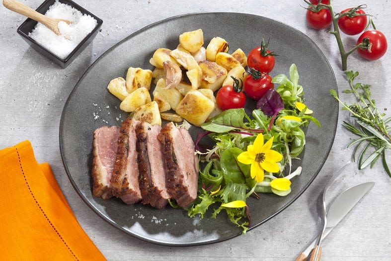
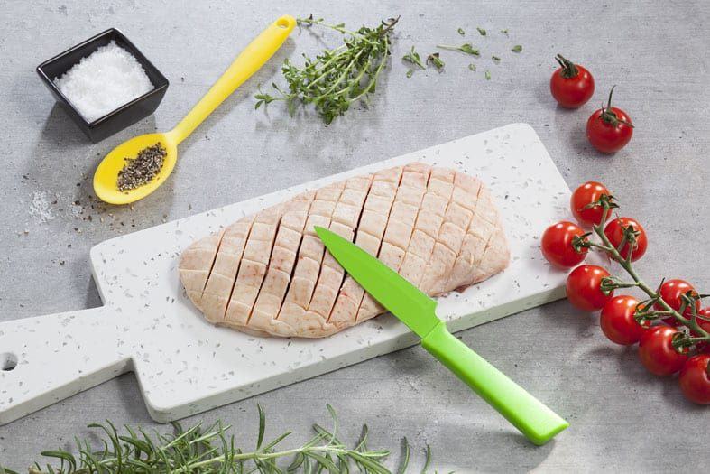
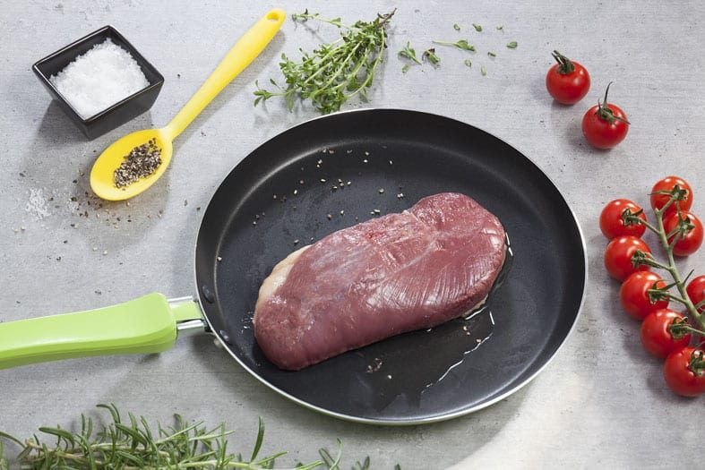
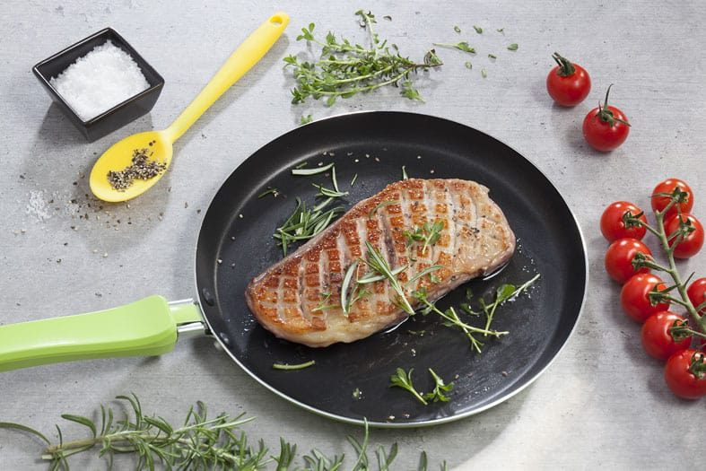

# Duck breast with crisp skin — *magret de canard* 🇫🇷
**Serves 4 · Prep 10 min · Cook about 25–40 min · Rest 5–10 min · Total 45–60 min · Medium**

> **Before you start:** this recipe assumes **skin-on, boneless breasts**, about **1 kg in total**, not a single 1 kg piece. Use two cold pans if needed so each skin lies flat. Have a meat thermometer ready; heat the oven to **160°C conventional** as a gentle finishing option.

*Photo: [Magret de France](https://lemagret.fr/la-cuisson-du-magret-canard/). The source photo shows a pink center and optional sides; these are not the fully cooked result or included ingredients.*

## The story
- **Origins:** The Gers tourism authority credits André Daguin in Auch with introducing fresh, steak-style magret in 1959, where confit had previously been the usual preparation (Tourisme Gers).
- **How it evolved:** This fresh-breast treatment became a southwest French classic. Strictly, *magret* comes from a fattened duck; ordinary duck breast is *filet* and often has less fat (Chef Simon).
- **Fun fact:** *Magret* comes from Occitan *magre*, meaning “lean” — despite the generous fat cap (Tourisme Gers). Pronounce it approximately **mah-GREH duh kah-NAR**.

## Grandma's tips 👵
No named grandmother's account was verified; these are credited French kitchen practices.
- **[confirmed by several sources]** Make *croisillons* in the skin without cutting the flesh (Magret de France; Régal; Ferme du Cousteau).
- **[confirmed by several sources]** Let the duck supply its own cooking fat (Ferme du Cousteau; Chef Simon).
- **[confirmed by several sources]** Pour off excess fat as it renders; save it for potatoes (Régal; Chef Simon).
- **[confirmed by several sources]** Rest before slicing (Régal; Magret de France).

## Ingredients — your approximately 1 kg pack
- [ ] **1,000 g skin-on duck breasts**, kept whole; usually 2–4 pieces
- [ ] **Fine salt, to taste** — **10 g is a typical starting allowance**, not a measured source consensus
- [ ] **Freshly ground black pepper, to taste** — approximately **1 g available**, a typical allowance

No added oil, butter, sugar or marinade is needed. For 900 g duck, use about 9 g salt as the same starting proportion. Sides are separate.

## Equipment
One or two heavy frying pans, tongs, sharp knife, heatproof fat bowl, rack over a roasting tray, meat thermometer. Avoid crowding a full kilogram into a small pan.

## Plan / mise en place
- Check whether you have thick *magrets* or thinner *filets*; thinner breasts need earlier temperature checks.
- Pat the skin completely dry; trim loose overhanging fat and visible sinew.
- Measure your salt allowance and pepper. Set out a clean resting plate.
- For a head start, salt and leave on a rack, covered loosely, in the fridge for 3 hours; optional, only within the meat's use-by date (Régal).
- Cook sides separately; finish them while the duck rests.

## Steps
1. [ ] Score the skin of **1 kg duck breasts** in a shallow diamond pattern about **1 cm apart**. Cut through skin into fat, **not into the meat**. Season with **salt to taste from the 10 g allowance**.

*Photo: [Magret de France](https://lemagret.fr/la-cuisson-du-magret-canard/).* 

2. [ ] Put the **seasoned breasts from step 1** skin-side down in **cold, dry pans**. Turn the heat to low or medium-low. Press gently with a spatula at first if the skin curls. *Look for gentle bubbling, not smoke.*

*Photo: [Magret de France](https://lemagret.fr/la-cuisson-du-magret-canard/).* 

3. [ ] Render skin-side down for roughly **10–20 minutes**, checking from **8 minutes** for thinner breasts. Spoon or carefully pour excess fat into the heatproof bowl. *The skin should become thin, golden and crisp, with much of the white fat melted.* Lower the heat if it darkens before the fat renders. Do not multiply time by the total pack weight.

⏱ **Timer: 10 min**, then inspect every 2–3 min — rendered skin, not a stopwatch alone.

4. [ ] Turn each breast and cook on the flesh side for an initial **3–5 minutes** over medium-low heat. Start checking the center of **each breast** with the thermometer inserted sideways into the thickest part.

⏱ **Timer: 3 min**, then check — flesh side browned, center measured.

*Photo: [Magret de France](https://lemagret.fr/la-cuisson-du-magret-canard/).* 

5. [ ] For the **fully cooked poultry option, reach 74°C in every breast**. If the surface is ready first, put the breasts **skin-side up** on the rack in the **160°C oven**; check after **5 minutes**, then every **2–3 minutes** until 74°C. This oven finish is an editorial adaptation for control, not a fixed source timing; thick pieces may need appreciably longer.

⏱ **Timer: 5 min**, then recheck frequently — **74°C at the center**.

> **Traditional pink option:** French culinary sources often serve duck breast *rosé*; Arnaud Sion describes about **55°C** at the center. This is **below the official 74°C poultry recommendation** and carries more foodborne-illness risk. It is not appropriate for pregnant people, young children, older adults or anyone immunocompromised. Color and a short rest do not make undercooked poultry safe. The main cooking instructions above use 74°C; pink duck will generally finish sooner.

6. [ ] Rest skin-side up for **5–10 minutes**, loosely tenting only if needed; tight foil softens the skin. Add **pepper to taste from the 1 g allowance**, slice across the grain and serve. Do not rely on carryover heat to reach the 74°C target.

⏱ **Timer: 5–10 min** — rest before slicing.

## Timer cheat-sheet
| Step | Initial timer | What decides the finish |
|---|---|---|
| 3 | 10 min | Thin, golden skin; commonly 10–20 min total |
| 4 | 3 min | Flesh-side browning and temperature |
| 5 | 5 min | 74°C in each breast; check every 2–3 min |
| 6 | 5–10 min | Rest before slicing |

## If it goes wrong
- **Dark skin, thick white fat:** heat was too high. Lower it; finish gently and check the center.
- **Pale, rubbery skin:** improve pan contact, pour off excess fat and give it more gentle rendering time.
- **One breast cooks sooner:** remove it individually; thickness matters more than combined weight.
- **Dry meat:** stop at the chosen measured endpoint; do not give every breast the thickest piece's time.

## Grocery list
- [ ] **Meat:** 1 kg skin-on duck breasts — already in your fridge
- [ ] **Pantry / Spices:** fine salt to taste (about 10 g allowance); black pepper to taste (about 1 g allowance)
- **Check you have:** salt and pepper. No extra fat is required for the skin-on version.

## Sources compared
| Source | Author / authority | Score / 3 | Main contribution |
|---|---|---|---|
| [Magret de France](https://lemagret.fr/la-cuisson-du-magret-canard/) | French magret industry site | 2 | Cold start; 10 min skin, 5 min flesh; step photos |
| [Régal](https://www.regal.fr/recettes/viandes-et-volailles/la-cuisson-du-magret-de-canard-a-la-poele-1071496) | Arthur Le Caisne | 3 | Very gentle rendering, about 20 min skin and 3 min flesh; 5 min rest |
| [Ferme du Cousteau](https://www.foiegrasaucousteau.com/recettes/la-cuisson-du-magret-de-canard) | Producer in the Gers | 2 | No added fat; 5 min skin and 3 min flesh, longer for more cooking |
| [Chef Simon](https://chefsimon.com/gourmets/chef-simon/recettes/magret-de-canard-saute) | Bertrand Simon | 3 | Moderate heat, repeated fat removal; starts warm after trimming fat |

**Reconciliation:** Plain breast, salt and pepper are the shared core; no source gives a precise salt weight, so the allowance is labelled typical. Skin-side times span **5–20 min**, with a median **10 min** among the three timed sources; flesh-side times **3–5 min**, median **3 min**. Régal receives greater weight for explaining slow rendering, so use a **10–20 min inspection range**, not a falsely precise average. Choose the cold start for an intact fat cap; Chef Simon's warm-pan method follows more extensive trimming. Times refer to individual breasts, not 1 kg as one piece. The 74°C endpoint follows official safety guidance, extending the traditional cooking schedule.

**Other references:** [Tourisme Gers — history](https://www.tourisme-gers.com/le-magret-de-canard-est-ne-a-auch/); [Arnaud Sion — traditional pink temperature](https://blog.lecomptoirdetoamasina.fr/comment-cuisiner-un-magret-de-canard/); [Santé Canada — safe cooking temperatures](https://www.canada.ca/fr/sante-canada/services/conseils-generaux-salubrite/temperatures-securitaires-cuisson-interne.html); [Santé Canada — leftovers](https://www.canada.ca/fr/sante-canada/services/conseils-generaux-salubrite/conseils-salubrite-restes-alimentaires.html). Culinary research uses French sources; the official safety references are French-language Canadian guidance.

## Tips & tricks
- Listen for a quiet sizzle and adjust heat before the skin burns (Régal's low-heat approach).
- Keep rendered fat separate from the serving juices; it makes a useful potato-cooking fat (Régal).
- A thinner everyday duck breast has less fat than *magret*; begin checking earlier (Chef Simon's distinction; timing adjustment is practical adaptation).

## Serve, store, reheat
Serve with sautéed potatoes and a green salad (Magret de France); a dry red wine is an optional pairing. Side and drink quantities are not included. Duck is best freshly cooked. Refrigerate leftovers promptly, within **2 hours**, in shallow containers at **4°C or below**; eat within **2–3 days**, or freeze. Reheat to **74°C throughout**; the center will no longer stay pink. See the linked Santé Canada guidance.

## Regional variants & substitutions
- **Southwest French base:** whole breast, its own fat, salt and pepper.
- **French variation:** an orange sauce is suggested by Chef Simon; it is a separate recipe, not silently added here.
- **Skinless adaptation:** skip scoring and rendering. Use **10 ml neutral oil (typical)** in a preheated pan over medium heat, brown both sides, then finish gently to **74°C**, checking each piece. Add this oil to your shopping list if using this variation; the main site's grocery list assumes skin-on meat.

## Confidence note
Strong agreement on gentle fat rendering and resting; substantial variation in timing and traditional doneness. You confirmed skin-on breasts; the exact breast count and thickness remain unknown. This card is scaled to 1 kg and has not been kitchen-tested.

**Link audit (2026-11-13):** All six French culinary/history pages returned HTTP 200. The two Santé Canada pages were read through web retrieval but timed out in local curl; retained as verified official references.
