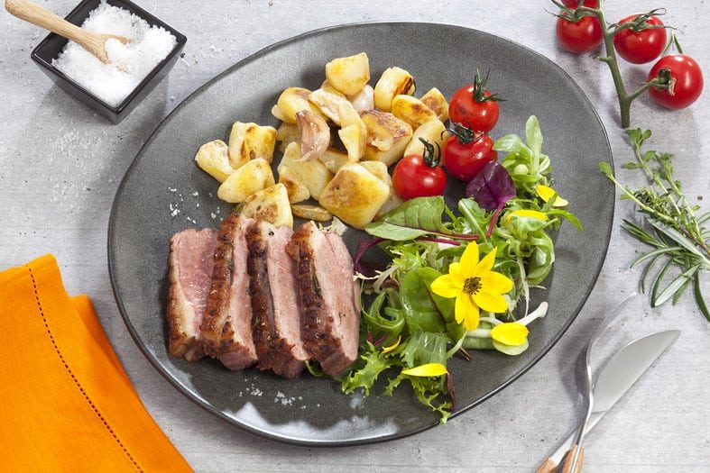
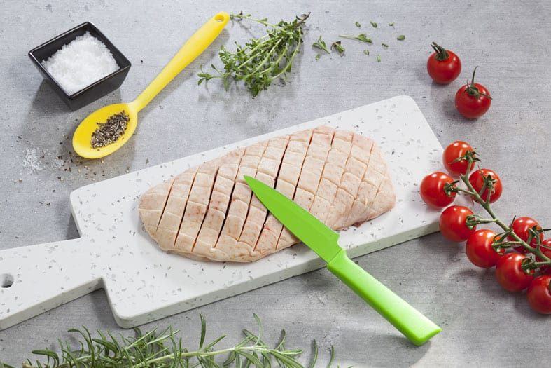
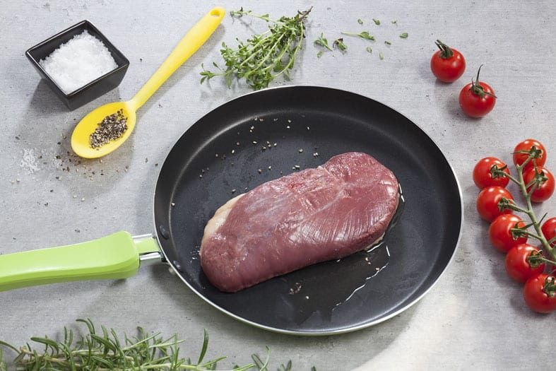
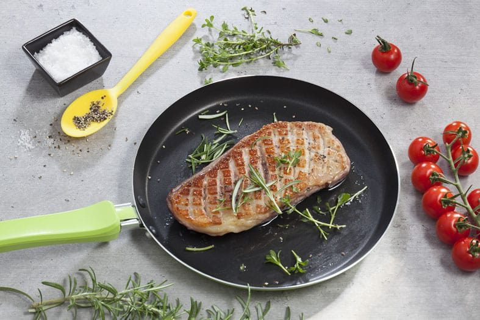

# Piept de rață cu piele crocantă — *magret de canard* 🇫🇷
**4 porții · Pregătire 10 min · Gătire circa 25–40 min · Odihnă 5–10 min · Total 45–60 min · Dificultate medie**

> **Înainte să începi:** rețeta presupune piept **dezosat, cu piele**, aproximativ **1 kg în total**, nu o singură bucată de 1 kg. Folosește două tigăi reci dacă este nevoie, ca pielea să stea complet lipită de fund. Pregătește termometrul; încălzește cuptorul la **160°C, fără ventilație**, pentru o eventuală finalizare blândă.

*Foto: [Magret de France](https://lemagret.fr/la-cuisson-du-magret-canard/). Fotografia sursei arată carne roz și garnituri opționale; acestea nu reprezintă rezultatul bine făcut și nu sunt incluse în ingrediente.*

## Povestea
- **Origini:** Organizația de turism din Gers îi atribuie lui André Daguin, la Auch, introducerea magretului proaspăt, gătit precum o friptură, în 1959; înainte era pregătit de obicei confit (Tourisme Gers).
- **Cum a evoluat:** Preparatul a devenit un clasic al sud-vestului Franței. Strict vorbind, *magret* provine de la rața îngrășată; pieptul obișnuit este *filet* și are adesea mai puțină grăsime (Chef Simon).
- **Curiozitate:** Numele vine din occitanul *magre*, „slab”, deși bucata are un strat generos de grăsime (Tourisme Gers). Pronunție aproximativă: **ma-GRE dă ca-NAR**.

## Sfaturi ca de la bunica 👵
Nu am verificat o mărturie a unei bunici anume; sunt practici din bucătăria franceză, cu surse.
- **[confirmat de mai multe surse]** Crestează pielea în romburi, *croisillons*, fără să tai carnea (Magret de France; Régal; Ferme du Cousteau).
- **[confirmat de mai multe surse]** Rața oferă singură grăsimea pentru gătit (Ferme du Cousteau; Chef Simon).
- **[confirmat de mai multe surse]** Scurge surplusul de grăsime pe parcurs și păstrează-l pentru cartofi (Régal; Chef Simon).
- **[confirmat de mai multe surse]** Lasă carnea să se odihnească înainte de feliere (Régal; Magret de France).

## Ingrediente — pentru pachetul tău de aproximativ 1 kg
- [ ] **1.000 g piept de rață cu piele**, bucăți întregi; de obicei 2–4 bucăți
- [ ] **Sare fină, după gust** — **10 g reprezintă un punct de pornire orientativ**, nu o cantitate comună precizată de surse
- [ ] **Piper negru proaspăt măcinat, după gust** — circa **1 g disponibil**, orientativ

Nu trebuie adăugate ulei, unt, zahăr sau marinadă. Pentru 900 g carne, pornește de la aproximativ 9 g sare, păstrând aceeași proporție. Garniturile se pregătesc separat.

## Ustensile
Una sau două tigăi grele, clește, cuțit ascuțit, bol termorezistent pentru grăsime, grătar deasupra unei tăvi și termometru pentru carne. Nu înghesui un kilogram într-o tigaie mică.

## Plan / pregătire
- Verifică dacă ai bucăți groase de *magret* sau *filet* mai subțire; la cele subțiri măsoară temperatura mai devreme.
- Șterge pielea foarte bine; îndepărtează grăsimea care atârnă și tendoanele vizibile.
- Pregătește cantitatea orientativă de sare și piperul. Pune deoparte un platou curat.
- Opțional, sărează și lasă pe grătar în frigider, acoperit lejer, cu 3 ore înainte; numai în termenul de valabilitate al cărnii (Régal).
- Gătește garnitura separat și termin-o cât timp rața se odihnește.

## Pași
1. [ ] Crestează pielea celor **1 kg de piept de rață** în romburi, cu tăieturi la circa **1 cm**. Taie pielea și grăsimea, **fără să ajungi în carne**. Pune **sare după gust, din cantitatea orientativă de 10 g**.

*Foto: [Magret de France](https://lemagret.fr/la-cuisson-du-magret-canard/).* 

2. [ ] Așază **bucățile condimentate la pasul 1**, cu pielea în jos, în **tigăi reci și uscate**. Aprinde focul mic spre mediu. Apasă ușor cu o spatulă la început dacă pielea se curbează. *Trebuie să apară bule mici și un sfârâit blând, fără fum.*

*Foto: [Magret de France](https://lemagret.fr/la-cuisson-du-magret-canard/).* 

3. [ ] Lasă grăsimea să se topească, cu pielea în jos, circa **10–20 de minute**; verifică de la **8 minute** bucățile mai subțiri. Scoate surplusul cu o lingură sau toarnă-l atent în bolul termorezistent. *Pielea trebuie să devină subțire, aurie și crocantă, iar mare parte din grăsimea albă să se topească.* Redu focul dacă se închide la culoare prea devreme. Nu înmulți timpul cu greutatea totală a pachetului.

⏱ **Cronometru: 10 min**, apoi verifică la 2–3 min — urmărește pielea, nu doar ceasul.

4. [ ] Întoarce fiecare bucată și gătește pe partea cărnii **3–5 minute pentru început**, la foc mic spre mediu. Măsoară centrul **fiecărei bucăți**, introducând termometrul din lateral în partea cea mai groasă.

⏱ **Cronometru: 3 min**, apoi verifică — carne rumenită și temperatură măsurată.

*Foto: [Magret de France](https://lemagret.fr/la-cuisson-du-magret-canard/).* 

5. [ ] Pentru varianta **gătită complet, atinge 74°C în fiecare bucată**. Dacă exteriorul este gata înaintea centrului, mută bucățile **cu pielea în sus**, pe grătar, în **cuptorul la 160°C**. Verifică după **5 minute**, apoi la fiecare **2–3 minute**, până ajung la 74°C. Finalizarea la cuptor este o adaptare editorială pentru control, nu un timp fix din surse; bucățile groase pot necesita semnificativ mai mult.

⏱ **Cronometru: 5 min**, apoi verifică frecvent — **74°C în centru**.

> **Varianta tradițională roz:** sursele culinare franceze servesc adesea pieptul *rosé*; Arnaud Sion descrie circa **55°C** în centru. Este **sub recomandarea oficială de 74°C pentru carnea de pasăre** și presupune un risc mai mare de toxiinfecție alimentară. Nu este potrivită pentru gravide, copii mici, vârstnici sau persoane cu imunitate scăzută. Culoarea și o odihnă scurtă nu fac sigură carnea insuficient gătită. Pașii principali folosesc 74°C; varianta roz se termină, în general, mai repede.

6. [ ] Lasă carnea **5–10 minute** cu pielea în sus; acoperă foarte lejer numai dacă este nevoie, deoarece folia strânsă înmoaie pielea. Pune **piper după gust, din cantitatea orientativă de 1 g**, feliază perpendicular pe fibre și servește. Nu te baza pe căldura reziduală pentru a atinge 74°C.

⏱ **Cronometru: 5–10 min** — odihnă înainte de feliere.

## Cronometre pe scurt
| Pas | Primul cronometru | Ce decide finalul |
|---|---|---|
| 3 | 10 min | Piele subțire, aurie; frecvent 10–20 min în total |
| 4 | 3 min | Rumenirea cărnii și temperatura |
| 5 | 5 min | 74°C în fiecare bucată; verificări la 2–3 min |
| 6 | 5–10 min | Odihnă înainte de feliere |

## Dacă ceva nu iese
- **Piele închisă, strat alb gros:** foc prea mare. Redu-l, continuă blând și măsoară centrul.
- **Piele palidă, elastică:** asigură contactul cu tigaia, scurge surplusul de grăsime și continuă topirea la foc blând.
- **O bucată este gata mai devreme:** scoate-o separat; grosimea contează mai mult decât greutatea totală.
- **Carne uscată:** oprește gătirea la temperatura aleasă; nu lăsa toate bucățile cât necesită cea mai groasă.

## Lista de cumpărături
- [ ] **Carne:** 1 kg piept de rață cu piele — îl ai deja în frigider
- [ ] **Cămară / Condimente:** sare fină după gust (circa 10 g disponibile); piper negru după gust (circa 1 g disponibil)
- **Verifică dacă ai:** sare și piper. Varianta cu piele nu cere grăsime în plus.

## Surse comparate
| Sursă | Autor / autoritate | Scor / 3 | Contribuție |
|---|---|---|---|
| [Magret de France](https://lemagret.fr/la-cuisson-du-magret-canard/) | Site al sectorului francez de magret | 2 | Pornire la rece; 10 min pe piele, 5 pe carne; fotografii |
| [Régal](https://www.regal.fr/recettes/viandes-et-volailles/la-cuisson-du-magret-de-canard-a-la-poele-1071496) | Arthur Le Caisne | 3 | Topire foarte blândă, circa 20 min pe piele și 3 pe carne; odihnă 5 min |
| [Ferme du Cousteau](https://www.foiegrasaucousteau.com/recettes/la-cuisson-du-magret-de-canard) | Producător din Gers | 2 | Fără grăsime adăugată; 5 min pe piele și 3 pe carne, mai mult pentru gătire suplimentară |
| [Chef Simon](https://chefsimon.com/gourmets/chef-simon/recettes/magret-de-canard-saute) | Bertrand Simon | 3 | Foc moderat, scurgerea repetată a grăsimii; tigaie caldă după îndepărtarea unei părți din grăsime |

**Cum am ales:** Pieptul simplu, sarea și piperul sunt baza comună; sursele nu cântăresc sarea, așadar cantitatea este orientativă. Timpii pe piele variază între **5 și 20 min**, cu mediana de **10 min** în cele trei surse cu durate; pe carne, **3–5 min**, mediana **3 min**. Acordăm mai multă greutate explicației lui Régal pentru topirea lentă și folosim un **interval de verificare de 10–20 min**, fără o medie fals precisă. Alegem pornirea la rece pentru stratul de grăsime intact; metoda lui Chef Simon pornește la cald după o curățare mai amplă. Duratele se aplică fiecărui piept, nu kilogramului ca unei singure bucăți. Temperatura de 74°C urmează ghidul oficial și prelungește programul tradițional.

**Alte referințe:** [Tourisme Gers — istorie](https://www.tourisme-gers.com/le-magret-de-canard-est-ne-a-auch/); [Arnaud Sion — temperatura tradițională roz](https://blog.lecomptoirdetoamasina.fr/comment-cuisiner-un-magret-de-canard/); [Santé Canada — temperaturi sigure](https://www.canada.ca/fr/sante-canada/services/conseils-generaux-salubrite/temperatures-securitaires-cuisson-interne.html); [Santé Canada — resturi alimentare](https://www.canada.ca/fr/sante-canada/services/conseils-generaux-salubrite/conseils-salubrite-restes-alimentaires.html). Cercetarea culinară folosește surse franceze; recomandările oficiale de siguranță sunt canadiene, în limba franceză.

## Trucuri și detalii
- Urmărește sfârâitul blând și reglează focul înainte să ardă pielea (metoda lentă Régal).
- Păstrează grăsimea topită separat de sucul pentru servire; este utilă la cartofi (Régal).
- Pieptul obișnuit, mai subțire, are mai puțină grăsime decât *magret*; verifică-l mai devreme (distincția Chef Simon; ajustarea timpilor este practică).

## Servire, păstrare, reîncălzire
Servește cu cartofi rumeniți și salată verde (Magret de France); opțional, alături merge un vin roșu sec. Garniturile și băutura nu sunt incluse în cantități. Rața este mai bună proaspăt gătită. Pune resturile repede la frigider, în cel mult **2 ore**, în recipiente puțin adânci, la **maximum 4°C**; consumă în **2–3 zile** sau congelează. Reîncălzește până la **74°C în interior**; centrul nu va mai rămâne roz. Vezi ghidul Santé Canada citat.

## Variante regionale și înlocuiri
- **Baza din sud-vestul Franței:** piept întreg, propria grăsime, sare și piper.
- **Variantă franceză:** Chef Simon sugerează sos de portocale; este o rețetă separată, nu un ingredient introdus aici fără explicație.
- **Adaptare fără piele:** omite crestarea și topirea grăsimii. Folosește **10 ml ulei neutru (orientativ)** într-o tigaie preîncălzită, la foc mediu; rumenește ambele părți și termină blând până la **74°C**, verificând fiecare bucată. Adaugă uleiul pe lista de cumpărături dacă folosești varianta; lista principală a site-ului presupune carne cu piele.

## Grad de încredere
Acord bun privind topirea blândă a grăsimii și odihna; variații mari ale timpilor și ale gradului tradițional de gătire. Ai confirmat că pieptul are piele; numărul și grosimea exactă a bucăților nu sunt cunoscute. Rețeta este calculată pentru 1 kg și nu a fost testată în bucătărie.

**Verificarea linkurilor (2026-11-13):** Cele șase pagini culinare și istorice franceze au răspuns cu HTTP 200. Cele două pagini Santé Canada au fost citite prin instrumentul web, dar accesul local prin curl a expirat; sunt păstrate ca referințe oficiale verificate.
