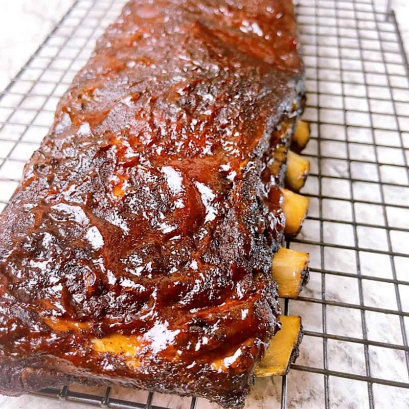

# Coaste BBQ la cuptor 🇺🇸 (*Oven BBQ Ribs*)
*Coaste de porc în stil american: frecate cu condimente uscate, învelite în folie, coapte încet la foc mic, apoi date cu sos și caramelizate sub grill*

*Foto: [Powell Family Cooking](https://www.powellfamilycooking.com/oven-baked-ribs/)*

## Povestea
- **Origini:** Coastele de barbecue americane autentice se gătesc încet într-o groapă cu jar, iar stilul Memphis are două feluri: coaste **„dry”** (doar un amestec de condimente uscate, mâncate fără sos) și **„wet”** (unse cu sos înainte, în timpul și după gătire). După al Doilea Război Mondial au apărut în Memphis localuri mici, „joints”, cu gropi de gătit făcute special. Unul dintre cele mai cunoscute, Charlie Vergos' Rendezvous, a început în 1948, când Vergos a găsit un tobogan pentru cărbuni în subsolul restaurantului lui și l-a transformat în groapă de gătit ([Wikipedia, Memphis-style barbecue](https://en.wikipedia.org/wiki/Memphis-style_barbecue)).
- **Cum a evoluat:** Rețeta de cuptor de acasă copiază ideea gropii: foc mic și timp lung. Autorii de rețete pe care i-am citit pun coastele în folie la **250–300 °F (120–150 °C)** pentru **2½–3½ ore**, apoi termină cu sos sub grill, ca să obțină glazura lipicioasă pe care ar da-o o groapă ([Splendid Table](https://www.splendidtable.org/story/2026/08/05/goto-barbecue-oven-ribs), [Powell Family Cooking](https://www.powellfamilycooking.com/oven-baked-ribs/)). *Este înlocuitorul bucătarului de acasă pentru groapă; nicio pagină nu pretinde că e barbecue „autentic”.*
- **Curiozitate:** World Championship Barbecue Cooking Contest din Memphis, ținut în fiecare mai, este trecut în Guinness World Records drept cel mai mare concurs de barbecue de porc din lume (Wikipedia).

## Sfaturile bucătarilor 👵
*Nu am găsit o bunică anume. Sfaturile vin de la autori culinari și bloguri americane, deci niciunul nu e o replică „de bunică”.*
- **Trage pielița subțire de pe partea cu os.** Este tare și împiedică condimentele să intre. Strecoară un cuțit fără vârf sub ea și trage cu un șervețel de hârtie pentru priză. **[confirmat de toate cele 6 rețete care o menționează]**
- **Șterge coastele foarte bine** înainte de condimentat (Splendid Table). **[tradiție]**
- **Muștar galben ca liant:** un strat subțire ajută condimentele să se lipească, iar „nu se simte muștarul” (Beach House Kitchen). Uleiul face același lucru (What's Mom Cookin'). **[tradiție, 2 surse]**
- **Înfășoară strâns, în două straturi dacă folia e subțire,** ca să nu scape aburul (What's Mom Cookin', Powell). **[confirmat de 2 surse]**
- **Verifică după simț, nu după ceas:** mișcă un os; trebuie să se miște ușor. Sau înfige un cuțit între două oase: aproape fără rezistență (Splendid Table). Spices Inc. dă **190 °F (88 °C)** în interior. **[confirmat de 2 surse]**
- **Scurge zeama înainte să dai cu sos** (Splendid Table, Beach House Kitchen). **[confirmat de 2 surse]**
- **Stai lângă cuptor la grill:** sosul trece de la caramelizat la ars în mai puțin de un minut (She's Not Cookin', Powell, What's Mom Cookin'). **[confirmat de 3 surse]**
- **„Nu e nicio știință” la amestecul de condimente:** începe cu părți egale de sare și zahăr brun, adaugă condimente și gustă-l pe vârful degetului (Dallas Moms). **[tradiție]**

**Porții** 4 · **Pregătire** 20 min · **Gătire** 3 h 15 min · **Total** aproximativ 3 h 50 min · **Dificultate** ușoară

> **Înainte să începi:** ai nevoie de o tavă cu margini, folie rezistentă și un cuptor cu grill care funcționează. Scoate coastele din frigider cu **30 de minute** înainte.

## Mise en place
- [ ] Încălzește cuptorul la **275 °F (135 °C)**, grătarul la mijloc (un al doilea grătar aproape de grill)
- [ ] Taie două foi de **folie rezistentă**, fiecare cam de două ori cât lungimea coastelor
- [ ] Amestecă **condimentele** (mai jos) într-un bol mic
- [ ] Șervețele de hârtie și un cuțit fără vârf pentru pielița de pe os

## Ingrediente
**Coaste**
- [ ] 1 grătar mare de coaste de porc (baby back sau St. Louis), cam **1,4 kg / 3 lb**
- [ ] Liant opțional: **2 linguri de muștar galben** sau 1 lingură de ulei neutru

**Amestec de condimente (pentru grătar)**
- [ ] 2 linguri de zahăr brun închis, bine presat
- [ ] 1 lingură de boia afumată
- [ ] 1 lingură de pudră de chili
- [ ] 2 lingurițe de sare grunjoasă (Diamond Crystal; **1½ lingurițe** dacă e sare fină)
- [ ] 1½ lingurițe de usturoi pudră
- [ ] 1½ lingurițe de ceapă pudră
- [ ] 1 linguriță de piper negru proaspăt măcinat
- [ ] 1 linguriță de muștar pudră
- [ ] 1 linguriță de chimion măcinat
- [ ] Opțional: ¼ linguriță de cayenne, 1 linguriță de liquid smoke (se unge pe coaste)

**Sos (alege unul):**
- [ ] **A:** cam **150 ml (⅔ de ceașcă) de sos BBQ gata făcut**, **sau**
- [ ] **B (de casă, de la Splendid Table, înjumătățit):** 180 ml (¾ de ceașcă) de ketchup, 60 ml (¼ de ceașcă) de apă, 2 linguri de oțet de orez sau de mere, 1½ linguri de sos Worcestershire, 1 lingură de sos de soia, 1 lingură de zahăr brun închis, 1½ lingurițe de sriracha, ½ linguriță de boia afumată, ½ linguriță de usturoi pudră, ½ linguriță de ceapă pudră, ½ linguriță de ghimbir măcinat

**La servire:** salată de cartofi, coleslaw sau pâine de porumb; ceapă verde (opțional).

## Pași
1. [ ] **Curăță:** șterge grătarul de coaste. Pe partea cu os, ridică pielița subțire la un capăt cu un cuțit fără vârf, prinde-o cu un șervețel și **trage-o dintr-o dată**. Dacă grătarul are o bucată de carne tare sus, taie-o.
2. [ ] **Condimentează:** unge ambele părți cu **2 linguri de muștar** (opțional) și apasă **tot amestecul de condimente** pe ambele părți, acoperind toată suprafața.
3. [ ] **Înfășoară:** pune grătarul cu **carnea în sus** pe folie, îndoaie marginile de două ori și strânge, apoi înfășoară în a doua foaie. Așază-l pe o tavă cu margini.
4. [ ] **Coace încet** la **275 °F (135 °C)**.
   ⏱ **Timer: 3 h** — *la 2½ h verifică: osul se mișcă liber, carnea se retrage de la capetele oaselor.*
   Cât se coace → fă sosul B din pasul 5, dacă îl folosești.
5. [ ] **Sos B (dacă îl folosești):** amestecă toate ingredientele sosului B într-o oală mică și fierbe **la foc mic 15 minute**, apoi dă deoparte. *Sari peste pas dacă folosești sos cumpărat.*
   ⏱ **Timer: 15 min** — *ușor îngroșat.*
6. [ ] **Verifică:** dacă nu sunt fragede la 3 h, închide din nou folia și coace încă **30 de minute**. Grătarele groase St. Louis pot cere până la 4 h (Splendid Table). Carnea de porc este sigură la **145 °F (63 °C)**; coastele devin fragede abia pe la **190 °F (88 °C)**.
7. [ ] **Deschide cu grijă** (abur fierbinte). Ridică grătarul de pe folie, scurge zeama și unge **partea cu os** cu **cam jumătate din sos**.
8. [ ] **Grill:** pune cuptorul pe **grill**, grătarul aproape de rezistență, cu partea cu os în sus. Dă la grill **4–5 minute**.
   ⏱ **Timer: 4–5 min** — *face bule, câteva pete arse. Nu pleca de lângă cuptor.*
9. [ ] **Întoarce** grătarul, unge **partea cu carne** cu **restul de sos** (păstrează o lingură pentru masă) și mai dă la grill **4–5 minute**.
   ⏱ **Timer: 4–5 min** — *lucios și caramelizat, marginile abia închise.*
10. [ ] **Odihnește** **10 minute**, apoi taie în porții de 4–6 coaste și servește cu sos în plus.

## Tabel timere
| Pas | Timp | Ce urmărești |
|---|---|---|
| 4 Cuptor, în folie | 3 h | Osul se mișcă, carnea se retrage |
| 5 Sos B | 15 min | Ușor îngroșat |
| 8 Grill, partea cu os | 4–5 min | Bule, pete de ars |
| 9 Grill, partea cu carne | 4–5 min | Lucios, caramelizat |
| 10 Odihnă | 10 min | Sucurile se liniștesc |

## Dacă iese prost
- **Încă tari:** închide din nou folia și coace încă **30 min**; verifică din nou mișcând un os.
- **Moi, se desfac în bucăți:** s-au copt prea mult. Ridică-le cu grijă, iar data viitoare verifică la 2½ h.
- **Sos ars:** grillul a fost prea aproape sau prea mult. Folosește un grătar mai jos și 3 minute pe parte.
- **Folia a curs:** folosește folie rezistentă, în două straturi, și coace mereu pe o tavă cu margini.
- **Prea puțină crustă:** folia fierbe condimentele la abur; crusta o dă grillul. Mai dă un minut la grill, urmărind atent.

## Servire, păstrare, reîncălzire
Servește fierbinte, cu sosul alături și coleslaw, salată de cartofi sau pâine de porumb. Pune resturile la frigider în maximum 2 ore și consumă-le în 3 zile. Reîncălzește înfășurate în folie la **275 °F (135 °C)** cam 20 de minute, apoi unge cu sos și dă 2 minute la grill.

---

## Listă de cumpărături
- [ ] **Carne:** 1 grătar mare de coaste de porc (baby back sau St. Louis), cam 1,4 kg
- [ ] **Condimente / cămară:** zahăr brun închis (2 linguri), boia afumată, pudră de chili, sare grunjoasă, usturoi pudră, ceapă pudră, piper negru, muștar pudră, chimion măcinat, muștar galben (opțional). Opțional: cayenne, liquid smoke
- [ ] **Sos (alege unul):** cam 150 ml de sos BBQ cumpărat, **sau** ketchup 180 ml, oțet de orez sau de mere, sos Worcestershire, sos de soia, sriracha, ghimbir măcinat, plus condimentele de mai sus
- [ ] **Echipament:** folie de aluminiu rezistentă
- **Verifică dacă ai:** sare, piper.

## Echipament
Tavă cu margini, folie de aluminiu rezistentă, pensulă de uns, cuțit fără vârf și șervețele de hârtie, oală mică (pentru sosul B), termometru cu citire instantanee (opțional).

## Surse comparate
| # | Sursă | Metodă | De ce a contat | Detaliu |
|---|---|---|---|---|
| 1 | [Powell Family Cooking, metoda cu folie](https://www.powellfamilycooking.com/oven-baked-ribs/) | 300 °F, folie 2½–3 h, sos, 30 min descoperit | Autoare cu nume (Jami Powell), amestec complet | 2 grătare pentru 6 porții; liquid smoke opțional |
| 2 | [The Splendid Table, Go-To Barbecue Oven Ribs](https://www.splendidtable.org/story/2026/08/05/goto-barbecue-oven-ribs) | 275 °F, folie 3½ h, grill 4–5 min pe parte | Site culinar de radio public, autoare de carte (Serena Wolf) | Testul cu osul care se mișcă, sos de casă; St. Louis până la 4 h |
| 3 | [She's Not Cookin'](https://shesnotcookin.com/fall-off-the-bone-oven-baked-ribs/) | 300 °F, folie 3 h pe grătar, grill 2–3 min | Bucătăreasă de acasă, 1 grătar baby back | Muștar pudră, condimente italiene, cayenne |
| 4 | [Beach House Kitchen](https://thebeachhousekitchen.com/oven-baked-ribs/) | 325 °F, folie 1½ h, apoi sos 20 min | Variantă mai rapidă | Liant de muștar galben; scurge grăsimea |
| 5 | [Spices Inc.](https://spicesinc.com/recipes/low-slow-oven-baked-ribs) | 250 °F, 2–2½ h descoperit + 2–2½ h cu sos, apoi 450 °F 5–10 min | Companie de condimente | Țintă 190 °F; taie bucata tare |
| 6 | [What's Mom Cookin'](https://whatsmomcookin.com/wprm_print/oven-baked-bbq-ribs) | 275 °F, 3 h, folie dublă, grill 5 min | Blog popular | Liant de ulei; odihnă 5 min |
| 7 | [Dallas Moms](https://dallasmoms.com/recipe/oven-pork-ribs) | Amestec de sare, zahăr, condimente (fără cantități) | Metoda amestecului | „Nu e nicio știință”; gustă amestecul |
| 8 | [foodiecrush, BBQ Baked Country Style Ribs](https://www.foodiecrush.com/oven-spare-ribs/) | 325 °F într-o oală acoperită cu ceapă și sos, 1½–2 h | 4,93 stele, 133 de voturi | Altă metodă (coaste country-style); doar ca variantă |

**Necitite:** Just a Taste, The Big Man's World, Fed & Fit și Southern Plate au dat eroare de acces (HTTP 403), așa că nu le-am folosit.

**Cum le-am împăcat:** temperaturile cuptorului au fost 250, 275, 275, 300, 300 și 325 °F (mediana cam **275–300 °F**) și am ales **275 °F** (135 °C). Timpii în folie au mers de la 1½ h la 325 °F la 3½ h la 275 °F; folosesc **3 h** și verific la 2½ h. Cantitate: sursele dau de la 0,5 la 1,25 lb de coaste pe persoană, deci **1,4 kg (3 lb)** pentru 4 e la mijloc. Cantitățile de condimente au fost scalate după greutate: zahăr 0,3–1,5 linguri pe lb (mediana cam 0,6) → **2 linguri**; sare 0,25–0,4 lingurițe pe lb → **2 lingurițe** la 1,4 kg, mai puțin decât regula de 1–2% pentru că sosul adaugă sare. Grill: 2–3, 4–5 și 5 min → **4–5 min pe parte**. Sos: ½–1 ceașcă la 3 lb → **150 ml**.

## Variante regionale și înlocuiri
- **Coaste „dry” Memphis:** sari peste sos și servește doar cu amestecul de condimente (Wikipedia descrie coastele dry). Deschide folia în ultimele 15 minute ca să se întărească crusta. *(Sugestia mea, nu dintr-o sursă.)*
- **Spare ribs / tăietură St. Louis:** mai cărnoase, cu 30–60 min mai mult (Splendid Table).
- **Coaste country-style, înăbușite** (foodiecrush): rumenește-le în făină, adaugă ceapă și un sos din ketchup, sherry, soia și Worcestershire, acoperă și coace la 325 °F 1½–2 h.
- **Descoperit întâi, apoi cu sos** (Spices Inc.): 250 °F, 2–2½ h descoperit, sos, apoi 2–2½ h acoperit.
- **Fără grill:** termină la **450 °F (230 °C)** 5–10 minute (Spices Inc.).

## Notă de încredere
Șapte surse americane se potrivesc la forma metodei: pielița scoasă, condimente uscate, folie, foc mic, sos sub grill. Diferă la temperatura cuptorului (250–325 °F) și la timp (1½–5 h), așa că am folosit mediane și un test după simț. Nu am gătit-o; cantitatea de condimente pe grătar este scalată din mai multe rețete și este partea care merită cel mai mult ajustată după gust.
