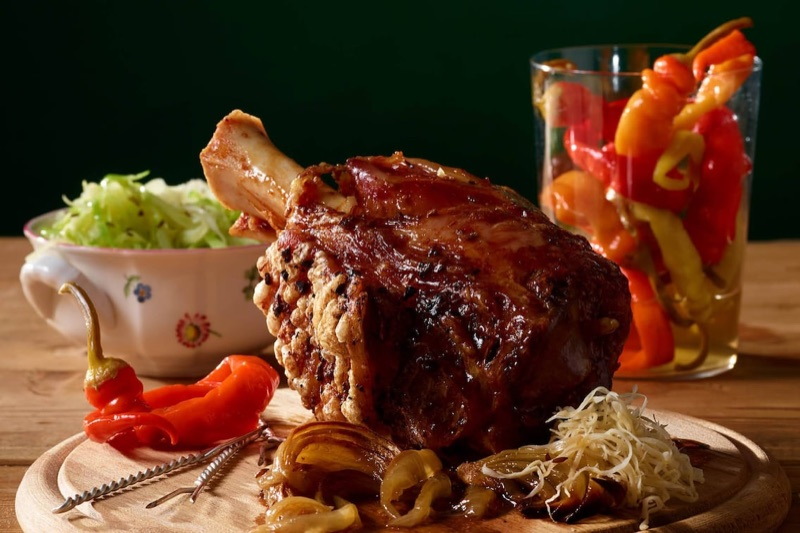

# Ciolan de porc la cuptor, stil austriac 🇦🇹 (*Schweinshaxe / Stelze*)
*Ciolan fiert domol, apoi copt în bere neagră până când pielea trosnește*

*Foto: [Servus](https://www.servus.com/r/schweinshaxe-mit-warmem-krautsalat)*

## Povestea
- **Origini:** *Haxe* (și *Hachse*, *Hax'n*) este un cuvânt vechi: în germana medie *hahsen* era încheietura piciorului de cal sau de câine, iar vechiul francez *hox(e)ne* („pulpă, gambă”) ar putea sta la baza lui. În limba scrisă din Austria bucata se numește ***Stelze*** ([Wien Geschichte Wiki](https://www.geschichtewiki.wien.gv.at/Haxe%28n%29), [ichkoche](https://www.ichkoche.at/-lexikon/h/haxn-hachse-oder-stelze)).
- **Cum a evoluat:** La Viena, ciolanul de porc copt întreg, servit cald sau rece, era o *„Unterlage zum Wein”* iubită (ceva consistent lângă vin), vândut la farfurie de măcelari și în *Heuriger* (crâșma cu vin nou). Ciolanul de vițel era cel gătit acasă ca fel principal (Wien Geschichte Wiki). Azi cea mai iubită variantă este *Grillstelze* crocantă (ichkoche).
- **Curiozitate:** aceeași bucată are alt nume în fiecare țară (*Haxn*, *Stelze*, iar în Elveția *Wädli*), iar Servus spune că o Haxe adevărată se mănâncă cu pâine țărănească crocantă, covrigei proaspeți sau *Erdäpfelknödel* (găluște de cartofi).

*Sursele pe care le-am putut citi nu dau o dată sau un inventator al preparatului, așa că nu inventez.*

## Sfaturile bucătarilor austrieci 👵
*Nu am găsit o bunică anume pentru acest preparat. Sfaturile vin de la reviste și site-uri de rețete austriece.*
- **Apa nu trebuie să fiarbă tare.** Ține-o chiar sub fierbere, altfel carnea iese fibroasă. *„Das Wasser soll nicht mehr kochen!”* (Gute Küche); „temperatură moderată” (Servus). **[confirmat de 2 surse]**
- **Taie pielea în romburi, niciodată în carne,** cu un cuțit foarte ascuțit (kochrezepte.at, Servus). **[confirmat de 2 surse]**
- **Crestează pielea cât ciolanul e încă cald de la fiert:** se taie mai ușor (Servus, Schweinshaxe mit warmem Krautsalat). **[tradiție]**
- **Unge cu sosul din tavă la fiecare 15 minute** în coacerea lungă (Servus, Knusprige Schweinshaxn; versiunea Servus cu salată „mehrmals”). **[confirmat de 2 surse]**
- **Sărează pielea după fierbere,** pe pielea gătită (Servus, Biersaftl). **[tradiție]**
- **Bere neagră, nu blondă,** pentru culoarea și gustul de malț al sosului (Servus, kochrezepte.at). **[tradiție]**
- **Ciolanul rece, rămas, cu muștar și un pahar de vin** este felul vechi vienez (Wien Geschichte Wiki). **[tradiție]**

**Porții** 4 · **Pregătire** 20 min · **Gătire** 2 h 50 min · **Total** aproximativ 3 h 20 min · **Dificultate** medie

> **Înainte să începi:** cumpără ciolane **proaspete, nesărate/neafumate** (nu *gepökelt*, vezi „Dacă iese prost”). Ai nevoie de o oală în care să se acopere cu apă și de o tavă adâncă. Scoate carnea din frigider cu 30 de minute înainte.

## Mise en place
- [ ] Oală cu **4 litri de apă** pe aragaz (nu o încălzi încă)
- [ ] Curăță și taie în jumătăți **2 cepe** și **4 căței de usturoi**
- [ ] Cuțit foarte ascuțit pentru crestat pielea
- [ ] Grătarul cuptorului în **treimea de jos**

## Ingrediente
**Ciolan și supa de fiert**
- [ ] 2 ciolane proaspete de porc (*Schweinshaxn*, picioare din spate), cam **1,2–1,5 kg bucata**
- [ ] 4 litri de apă
- [ ] 1 lingură de sare pentru apă + **cam 1 linguriță** pentru frecat pielea
- [ ] 2 cepe, tăiate în jumătăți (pot rămâne cu coajă)
- [ ] 4 căței de usturoi, tăiați în jumătăți
- [ ] 4 foi de dafin
- [ ] 2 lingurițe de semințe de chimen (*Kümmel*)
- [ ] 2 lingurițe de boabe de piper negru
- [ ] Opțional (câte o sursă): 6 boabe de ienibahar, 1 linguriță de ienupăr, 1 cui de garoafe

**Copt și sos**
- [ ] 250 ml bere neagră (*dunkles Bier*)
- [ ] 250 ml din supa de fiert
- [ ] 1 linguriță de zahăr
- [ ] 1 linguriță de amidon de porumb (*Speisestärke*) + 2 linguri de apă rece
- [ ] Sare și piper

**Salată caldă de varză (*warmer Krautsalat*, Servus)**
- [ ] 1 căpățână mică de varză timpurie (*Frühkraut*), cam 700 g *(tipic; Servus nu dă greutatea)*
- [ ] 80 g ceapă
- [ ] 4 linguri de ulei de floarea-soarelui
- [ ] 150 ml supă limpede de legume (sau de carne)
- [ ] 1 linguriță de semințe de chimen
- [ ] 50 ml oțet de mere sau de vin
- [ ] 1 lingură de zahăr
- [ ] Sare și piper

**La servire:** muștar, hrean ras (*Kren*), ardei murați (*Pfefferoni*), pâine țărănească, covrigei sau găluște de cartofi.

## Pași
1. [ ] **Fierbe:** pune **4 litri de apă** cu **1 lingură de sare**, **2 cepe**, **4 căței de usturoi**, **4 foi de dafin**, **2 lingurițe de chimen** și **2 lingurițe de piper** la fiert. Scade focul, adaugă **cele 2 ciolane** și ține apa *abia tremurând*, niciodată în clocot.
   ⏱ **Timer: 90 min** — *carnea cedează la apăsare, dar nu se desprinde încă de os.*
   Cât fierbe → fă salata de varză din pasul 9.
2. [ ] **Scoate și usucă:** scoate ciolanele și tamponează-le cu șervețele de bucătărie. **Păstrează 250 ml din supă** (și ceapa și usturoiul). Cât pielea e încă caldă, crestează-o în **romburi** la cam 1 cm, *doar pielea, nu și carnea.* Freacă pielea cu **cam 1 linguriță de sare** și puțin piper.
3. [ ] **Încălzește** cuptorul la **180 °C cu ventilator** (cam 200 °C sus-jos).
4. [ ] **Pregătește tava:** pune ciolanele în picioare într-o tavă adâncă. Toarnă **250 ml bere neagră** și **250 ml din supă** și împrăștie **ceapa și usturoiul fierte** în jur.
5. [ ] **Coace** pe grătarul de jos, turnând sosul din tavă peste piele **la fiecare 15 minute**.
   ⏱ **Timer: 60 min** — *pielea începe să se umfle în bășici, sosul e închis la culoare și scăzut.*
6. [ ] **Crocant:** crește cuptorul la **220 °C** și coace **fără să mai ungi**. Urmărește din minutul 10.
   ⏱ **Timer: 15–20 min** — *pielea umflată, aurie și crocantă la ciocănit.*
7. [ ] **Odihnește** ciolanele pe un tocător, acoperite lejer, **10 minute**. Carnea trebuie să se desprindă de os cu furculița. Carnea de porc e sigură la **63 °C**, dar bucata asta e fragedă abia mult peste.
8. [ ] **Sos:** strecoară sosul din tavă într-o oală. Topește **1 linguriță de zahăr** într-o tigaie uscată până se rumenește ușor (câteva secunde), adaugă sosul și fierbe până scade cu o treime. Amestecă **1 linguriță de amidon** cu **2 linguri de apă rece**, adaug-o și fierbe **1 minut**. Potrivește de sare și piper.
   ⏱ **Timer: 10 min** — *sosul îmbracă lingura.*
9. [ ] **Salata de varză** (cât fierbe ciolanul): taie **700 g de varză** foarte fin. Înmoaie **80 g de ceapă tăiată** în **4 linguri de ulei**, adaugă **150 ml de supă** și **1 linguriță de chimen** și fierbe **5 minute**. Amestecă **50 ml de oțet**, **1 lingură de zahăr**, sare și piper, adaugă varza, dă **o singură dată** în clocot și ia de pe foc. *Trebuie să rămână puțin crocantă.*
10. [ ] **Servește** ciolanele cu sosul, salata caldă de varză, muștar, hrean și ardei murați.

## Tabel timere
| Pas | Timp | Ce urmărești |
|---|---|---|
| 1 Fiert | 90 min | Abia tremură; carnea cedează sub deget |
| 5 Copt cu uns | 60 min | Sos închis, pielea face bășici |
| 6 Crocant | 15–20 min | Umflată, aurie, trosnește |
| 7 Odihnă | 10 min | Carnea se desprinde de os |
| 8 Sos | 10 min | Îmbracă lingura |

## Dacă iese prost
- **Pielea rămâne moale și elastică:** a fost umedă sau cuptorul prea rece. Tamponeaz-o, urcă la **230 °C** încă 10 minute sau pune gratarul sus 3–5 minute (supraveghează).
- **Carnea e tare:** apa a fiert tare sau mai are nevoie de timp. Pune-o înapoi în cuptor la **180 °C** cu puțină supă, 30 de minute.
- **Prea sărat:** ai folosit un ciolan *gepökelt* (sărat/conservat). Cel sărat se fierbe mai puțin și fără sare în apă (Servus îl fierbe doar 30 min).
- **Sos subțire:** fierbe-l mai mult sau adaugă puțin amidon dizolvat.

## Servire, păstrare, reîncălzire
Servește imediat, cu sosul, salata caldă de varză, muștar și hrean, plus pâine, covrigei sau *Erdäpfelknödel*. Pune resturile la frigider în maximum 2 ore și consumă-le în 3 zile. Reîncălzește neacoperit la **180 °C**, 20 de minute, ca să revină crocanțul. Ciolanul rece cu muștar și murături și un pahar de vin este felul vechi din Heuriger.

---

## Listă de cumpărături
- [ ] **Carne:** 2 ciolane proaspete de porc (1,2–1,5 kg bucata, picior din spate, nesărat)
- [ ] **Legume:** 2 cepe + 80 g ceapă pentru salată, 1 căpățână mică de varză timpurie (cam 700 g), 4 căței de usturoi
- [ ] **Lichide:** 250 ml bere neagră, 150 ml supă limpede de legume sau de carne
- [ ] **Condimente / cămară:** foi de dafin (4), semințe de chimen, boabe de piper negru, zahăr, amidon de porumb, ulei de floarea-soarelui, oțet de mere sau de vin. Opțional: ienibahar, ienupăr, cuișoare
- [ ] **Specialități:** muștar, hrean, ardei murați (*Pfefferoni*), pâine țărănească, covrigei sau găluște de cartofi
- **Verifică dacă ai:** sare, piper, ulei de floarea-soarelui.

## Echipament
Oală mare (6 L sau mai mare), tavă adâncă, cuțit foarte ascuțit, șervețele de bucătărie, lingură mare pentru uns, oală mică pentru sos, termometru de carne (opțional).

## Surse comparate
| # | Sursă | Metodă | De ce a contat | Detaliu |
|---|---|---|---|---|
| 1 | [Servus, Schweinshaxe mit warmem Krautsalat](https://www.servus.com/r/schweinshaxe-mit-warmem-krautsalat) | Ciolan sărat: fiert 30 min, 200 °C 30 min, 160 °C 90 min cu 250 ml bere, 200 °C 15 min | Revistă austriacă, rețetă cu autor | Salată caldă de varză; crestezi pielea caldă |
| 2 | [Servus, Knusprige Schweinshaxn](https://www.servus.com/r/knusprige-schweinshaxn) | Fără fierbere: 200 °C 30 min, 160 °C 120 min, 220 °C 30 min, bere neagră la final | Rețetă de revistă, ciolan crud | Se unge la 15 min; 150 ml bere neagră |
| 3 | [Servus, Schweinshaxn mit Biersaftl und Radi](https://www.servus.com/r/schweinshaxn-mit-biersaftl-und-radi) | Fiert 150 min, 180 °C 60 min cu 250 ml bere + 1 L supă, 220 °C pentru crocant | Revistă, cele mai multe condimente, sos cu caramel | Sărezi pielea după fierbere; ienibahar, anason |
| 4 | [kochrezepte.at, Besoffene Schweinshaxen](https://www.kochrezepte.at/besoffene-schweinshaxen-rezept-3246) | Fără fierbere: 160 °C 60 min, 180 °C 70 min, apoi crocant; 300 ml apă + 300 ml bere neagră | Bază de rețete austriacă | Pielea se taie fără să atingi carnea |
| 5 | [Gute Küche, Schweinshaxen](https://www.gutekueche.at/schweinshaxen-rezept-12806) | Fiert 90 min (apa nu trebuie să fiarbă), 180 °C 60 min | 4,42 stele, 24 de voturi | Se șterge înainte de copt; 4 L apă, 1,5 kg carne pentru 4 |
| 6 | [Wien Geschichte Wiki](https://www.geschichtewiki.wien.gv.at/Haxe%28n%29), [ichkoche, lexicon](https://www.ichkoche.at/-lexikon/h/haxn-hachse-oder-stelze) | Istorie și termeni | Wiki de istorie al orașului | *Stelze* e cuvântul austriac scris |

**Cum le-am împăcat:** trei din cinci rețete fierb mai întâi (30, 90 și 150 min → mediana **90 min**). Cuptor: faza joasă 160–180 °C, final 200–220 °C → **180 °C, apoi 220 °C**. Bere: 150 / 250 / 250 / 300 ml → **250 ml**. Cantitate: Servus folosește 1–1,5 kg pe ciolan, iar Gute Küche 1,5 kg pentru 4, așa că **două ciolane pentru 4** e generos, dar cu mult os. Sarea din apa de fiert a variat de la 2 lingurițe în 4 L la 2–3 lingurițe în 2 L, așa că folosesc **1 lingură în 4 L** plus sare pe piele. Pagina ichkoche *Bayrische Bierhaxe* s-a încărcat fără o rețetă ce se putea citi, deci nu am folosit-o.

## Variante regionale și înlocuiri
- **Fără fierbere, direct în cuptor** (Servus Knusprige, kochrezepte.at): coacere mai lungă (cam 2,5–3 h) și carne puțin mai uscată.
- **Bere la final:** Servus Knusprige unge cu bere neagră în ultimele 30 de minute; eu pun berea de la început și nu mai ung, pentru un crocant mai uscat.
- **Stelze sărată (*gepökelte*)** (versiunea Servus cu salată): fierbe doar 30 de minute, apoi coace.
- **Ciolan de vițel (*Kalbshaxe*):** versiunea obișnuită de acasă la Viena (Wien Geschichte Wiki); mai delicat.
- **Fără bere:** folosește supă (rețeta Gute Küche nu are bere).

## Notă de încredere
Cele cinci rețete austriece se potrivesc la pielea crestată, chimen, usturoi, bere neagră și final fierbinte. Diferă la fierbere (de la deloc la 150 min) și la temperaturi, așa că timpii de mai sus sunt mediane. Greutatea căpățânii de varză este estimarea mea; Servus nu o dă.
