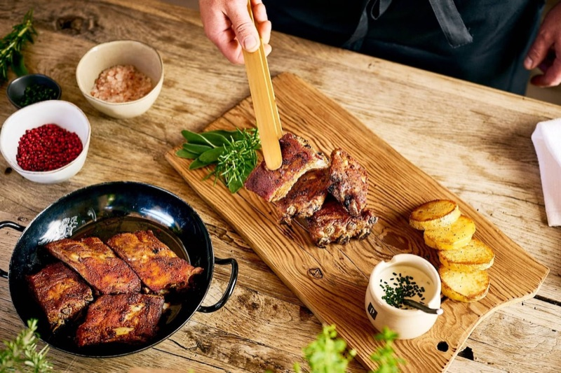

# Schweinsripperl aus dem Backrohr 🇦🇹
*Austrian pork ribs rubbed with caraway and garlic, roasted in a home oven until crisp. Hearty *Gasthaus* food, not American BBQ.*

*Photo: [Servus](https://www.servus.com/r/ripperl-mit-ofenkartoffeln-und-schnittlauch-sauerrahmsauce)*

## The story
- **Origins:** *Ripperl* is the Austrian word for pork ribs. In the sources the dish is plain home cooking: ribs rubbed with salt, pepper, **caraway** and **garlic**. kochrezepte.at says the same marinade also suits a *Schweinsbraten* (roast pork). Christoph Wagner's *Ripperlfleisch* braises them under a lid with lard and onions ([ichkoche](https://www.ichkoche.at/ripperlfleisch-rezept-9783)).
- **How it evolved:** The traditional version uses only caraway, garlic, salt and pepper ([Gute Küche](https://www.gutekueche.at/schweinsripperl-rezept-29081)). Newer Austrian versions add paprika, mustard, ketchup, beer or honey-soy marinades, and a long marinating time (kochrezepte.at, Gute Küche). A commenter on ichkoche remembers that "bei meiner Oma hieß das Kleinfleisch": ribs rubbed with spices and a little oil, roasted with onions and potato chunks on a wood stove, then topped up with wine.
- **Fun fact:** Austrian sites list *Spareribs* separately, and those recipes are mostly barbecue-style (ketchup, honey, chili). The caraway-and-garlic Ripperl below is the other, plainer tradition.

*I found no dated history for the dish, so I give none.*

## Austrian cooks' tips 👵
*No named grandmother found. The one grandmother mention is a reader's comment; everything else comes from Austrian recipe sites.*
- **Marinate for a day if you can.** kochrezepte.at says at least one day; Gute Küche's beer marinade needs only 4 hours. **[confirmed by 2 sources]**
- **Cook them once covered, then uncovered:** ichkoche braises under a lid, then roasts open; Servus covers with foil and water. The meat stays juicy and the surface still browns. **[confirmed by 2 sources]**
- **Turn them several times** while roasting (kochrezepte.at, ichkoche Asian version). **[tradition]**
- **Remove the silver skin (*Silberhaut*) on the bone side** so the rub gets in and the meat is not chewy (Gute Küche, spareribs recipes). **[confirmed by several sources]**
- **Finish with strong top heat** for about **5 minutes** with the fat side up (ichkoche, Servus). **[confirmed by 2 sources]**
- **Pour some water over them halfway** if the tray dries out (Gute Küche, Gebratene Ripperl). **[tradition]**
- *"Bei meiner Oma ... im Rohr anbraten, mit Wein gut angießen"* (a reader on ichkoche): grandma's way was onions, potatoes and wine in the roasting dish. **[reader's tradition, one comment]**

**Serves** 4 · **Prep** 20 min (+ marinating) · **Cook** 1 h · **Total** about 1 h 25 min · **Difficulty** easy

> **Before you start:** marinate the ribs **at least 4 hours, ideally overnight** in the fridge. Take them out 30 minutes before roasting. You need a baking tray with sides, foil and a rack.

## Mise en place
- [ ] Ask the butcher to cut the **2 kg ribs** into 3–4 slabs, or cut them at home
- [ ] Peel and chop **5 garlic cloves**
- [ ] Mix the marinade the day before (see Ingredients)
- [ ] Oven rack on the **middle level**

## Ingredients
**Ribs and marinade**
- [ ] 2 kg pork ribs (*Schweinsripperl*, with some meat on)
- [ ] 3 tsp salt (about 18 g)
- [ ] ½ tsp ground black pepper
- [ ] 1 tbsp caraway seeds (*Kümmel*)
- [ ] 5 garlic cloves, finely chopped
- [ ] 3 tbsp oil (about 45 ml)
- [ ] 1 tsp sweet paprika
- [ ] 1 tsp mustard
- [ ] Optional: 2 tsp hot ketchup (only kochrezepte.at uses it)

**For roasting**
- [ ] About 100 ml water for the tray (1 cm deep)

**To serve (choose one or both):**
- [ ] *Erdäpfelsalat* ([Austrian potato salad](recipe:erdaepfelsalat)), kochrezepte.at's pairing
- [ ] Oven potatoes and **chive sour-cream sauce** (Servus): **1 kg potatoes**, **1 bunch chives**, **200 g sour cream**, **200 g yogurt**, a splash of vinegar, a pinch of sugar, salt and pepper

## Steps
1. [ ] **Prepare the ribs:** rinse them, pat dry with kitchen paper and, if present, pull off the **silver skin** on the bone side.
2. [ ] **Marinate:** stir **3 tsp salt**, **½ tsp pepper**, **1 tbsp caraway**, **5 chopped garlic cloves**, **3 tbsp oil**, **1 tsp paprika** and **1 tsp mustard** (and **2 tsp ketchup** if using) into a thick paste. Rub it on both sides, cover and chill.
   ⏱ **Timer: 4 h minimum, or overnight** — *the paste clings to the meat.*
3. [ ] **Preheat** the oven to **180 °C fan**. Line a tray with sides with foil or baking paper and lay the ribs **bone side down**.
4. [ ] **Cover and cook:** pour about **100 ml water** (1 cm) into the tray, cover tightly with foil and roast.
   ⏱ **Timer: 30 min** — *meat starting to pull away from the bone ends.*
5. [ ] **Uncover and brown:** remove the foil, turn the ribs and roast on.
   ⏱ **Timer: 25 min** — *golden-brown, edges crisp; turn once or twice.*
6. [ ] **Crisp:** put the **top heat or grill** on for **5 minutes**, fat side up, watching closely.
   ⏱ **Timer: 5 min** — *dark and crackling at the edges, not burnt.*
7. [ ] **Check:** the meat should pull off the bone with little effort. Pork is safe at **63 °C**; ribs are tender at around **90 °C** at the bone. If not tender, cover again for 15 minutes.
8. [ ] **Rest** **5 minutes**, then cut between the bones and serve with potato salad or oven potatoes and chive sauce.

**Chive sauce (optional):** stir **1 bunch chopped chives**, **200 g sour cream**, **200 g yogurt**, a splash of **vinegar**, a pinch of **sugar**, salt and pepper together and chill.

## Timer cheat-sheet
| Step | Time | Look for |
|---|---|---|
| 2 Marinate | 4 h–overnight | Paste clings |
| 4 Covered roast | 30 min | Meat pulls back from bone ends |
| 5 Uncovered roast | 25 min | Golden, turn once or twice |
| 6 Top heat | 5 min | Crisp, not burnt |
| 8 Rest | 5 min | Juices settle |

## If it goes wrong
- **Ribs chewy:** they needed longer, or the silver skin was left on. Cover with foil and roast another **15–20 min**.
- **Dry:** the tray ran dry. Add a splash of water, and cover for the first half.
- **Too salty:** kochrezepte.at's 2 tsp per 2 kg and Gute Küche's 2 tbsp per 2 kg differ by three times. The 3 tsp above is in the middle; use 2 tsp if your ribs are small.
- **Garlic burnt:** wipe off loose garlic from the surface before the top-heat step.

## Serve, store, reheat
Serve hot, with Erdäpfelsalat or oven potatoes, pickled peppers and gherkins, or garlic bread (ichkoche's suggestions). Refrigerate leftovers within 2 hours and eat within 3 days. Reheat at **180 °C** for 15 minutes, covered, then 5 minutes uncovered.

---

## Grocery list
- [ ] **Meat:** 2 kg pork ribs (*Schweinsripperl*)
- [ ] **Produce:** 1 head garlic (5 cloves); for the sides: 1 kg potatoes, 1 bunch chives
- [ ] **Dairy:** for the chive sauce: 200 g sour cream, 200 g yogurt
- [ ] **Pantry / spices:** caraway seeds, sweet paprika, mustard, oil, salt, pepper. Optional: hot ketchup, vinegar, sugar
- **Check you have:** salt, pepper, oil.

## Equipment
Baking tray with sides, foil, baking paper, kitchen paper, big bowl for the marinade, tongs.

## Sources compared
| # | Source | Method | Why it counted | Notable detail |
|---|---|---|---|---|
| 1 | [kochrezepte.at, Gebratene Schweinsripperln](https://www.kochrezepte.at/gebratene-schweinsripperln-rezept-469) | 2 kg; marinate ≥ 1 day; 165 °C, 40–55 min, turn often | Austrian recipe database | Paprika, mustard, hot ketchup; serve with Erdäpfelsalat |
| 2 | [Gute Küche, Schweinsripperl](https://www.gutekueche.at/schweinsripperl-rezept-29081) | 2 kg; 190 °C, 40 min; caraway, garlic, salt, pepper | 4.45 stars, 44 ratings | The plain, traditional version |
| 3 | [Servus, Ripperl mit Ofenkartoffeln](https://www.servus.com/r/ripperl-mit-ofenkartoffeln-und-schnittlauch-sauerrahmsauce) | 4 × 600 g loin ribs; 180 °C 45 min, then 110 °C 1 h under foil in 1 cm water, 5 min to crisp | Austrian magazine | Paprika, rosemary; chive sour-cream sauce |
| 4 | [ichkoche, Ripperlfleisch](https://www.ichkoche.at/ripperlfleisch-rezept-9783) | 180 °C: 15–20 min under lid with ½ L water, onions, lard, then 20–30 min open | Recipe by Christoph Wagner; reader comment about grandmother | Braterdäpfel, pickled peppers, gherkins |
| 5 | [Gute Küche, Schweineripperl in Biermarinade](https://www.gutekueche.at/schweineripperl-in-biermarinade-aus-dem-backrohr-rezept-37292) | Beer + Dijon + thyme marinade 4 h; 170 °C 40 min | 4.73 stars, 106 ratings | Brush with oil before the oven |
| 6 | [Gute Küche, Gebratene Ripperl](https://www.gutekueche.at/gebratene-ripperl-rezept-15902) | Honey-soy-garlic paste; 180 °C, 30 + 30 min, water after 30 min | 4.27 stars, 168 ratings | Variant, not caraway-based |

**How I reconciled them:** per 2 kg of ribs, salt ranged from 12 g (kochrezepte.at, 2 tsp) to about 36 g (Gute Küche, 2 tbsp); I use **18 g**. Caraway: 2 tsp to 2 tbsp → **1 tbsp**. Garlic: 4 and 6 cloves → **5**. Oil: 50 ml → **45 ml**. Oven: 165–190 °C → **180 °C**. Time: dry-roast recipes need 40–55 min; the covered-then-open methods 35–50 min plus; Servus goes low and slow for 110 min. I use **30 min covered + 25 min open + 5 min top heat** (a synthesis of ichkoche and Servus, longer than ichkoche's because a 2 kg batch is meatier). The honey-soy, orange-teriyaki and BBQ Spareribs recipes on the same Austrian sites are not caraway-based, so they are listed only as variants. I did not read the ichkoche *Spareribs mit Honig-Chilibeize* page (it is an Asian recipe).

## Regional variants & substitutions
- **Beer marinade** (Gute Küche): 8 tbsp light beer, 3 tbsp Dijon mustard, thyme, garlic, 4 h; 170 °C for 40 min.
- **Honey-soy** (Gute Küche): 8 tbsp soy sauce, 1 tbsp honey, 4 garlic cloves, 2 tbsp oil; 180 °C for 60 min. Not caraway-based.
- **Low and slow** (Servus): 45 min at 180 °C, then 1 h at 110 °C under foil in 1 cm water, 5 min uncovered. More tender, less crust.
- **Onions, potatoes and wine in the dish** (reader's grandmother, ichkoche): a one-pan *Kleinfleisch* way.
- **BBQ-style Spareribs** (kochrezepte.at, Gute Küche): marinade in layers at 210 °C or pre-bake then grill. Not traditional Ripperl.

## Confidence note
Austrian sources agree on caraway, garlic, salt and pepper as the base and on a rest or marinating time, but not on the temperature (165–190 °C) or whether to cover; the time plan above is my own reconciliation of those and was not tested.
